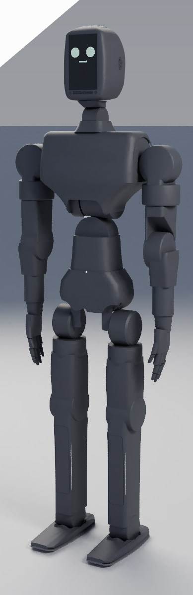

# rose

rose is Muni's humanoid robot line: three sizes (mini, full, mega) meant to share
one structure and one electronics stack. The name is the past tense of *rise*.

**State today: design stage.** This repository is CAD sources, sizing and checking
scripts, fabrication packages, PCB designs and renders. It records no built robot:
the fab packages say nothing has been ordered or cut
([`body/fab/README.md`](body/fab/README.md), [`arm/V10.8.md`](arm/V10.8.md)),
and every image here is a render
([`head/renders/release/README.md`](head/renders/release/README.md)).
Numbers are model outputs or vendor figures, not measurements, unless a file says
otherwise. Muni's overall plan, and where rose sits in it, is at
<https://muni.works/research>.

| | |
|---|---|
|  |  |
| rose mini with the cortex head (render) | rose full, same design language (render) |

## Layout

| path | what it is |
|---|---|
| [`body/`](body) | The humanoid: mini (100 cm, 22 DoF, router-cut 3.2 mm plate, printed skins) and full, generated from one set of Python sources. Its fab package is in [`body/fab/`](body/fab). |
| [`head/`](head) | cortex, the head: a detachable module with the compute, battery, cameras, mics and a screen face, which docks on the neck or sits on a desk. Spec in [`SPEC.md`](head/SPEC.md); the "node" redesign, locked at v1.21 for a first print, in [`NODE-BRIEF.md`](head/NODE-BRIEF.md). |
| [`arm/`](arm) | lymb, a RobStride table arm that is also rose's arm. Current revision v10.8 ([`V10.8.md`](arm/V10.8.md)); v9 is kept bit-identical with a complete fab package. |
| [`electronics/`](electronics) | The boards: [`brain/`](electronics/brain) (RK3588S2 + STM32H7 compute), [`limb-controller/`](electronics/limb-controller) (one per limb), and [`brand/`](electronics/brand) (logo footprints for board art). |
| [`sizing/`](sizing) | The size ladder ([`family.py`](sizing/family.py)) and the mega actuator sizing ([`MEGA-SIZING.md`](sizing/MEGA-SIZING.md)). |

Each folder has a README with its run commands. Earlier design passes (the first
950 mm mini, the MyActuator full at 1800 mm, the rose-1 mega study, the quadruped
leg the body grew out of, the first box arm, the head mockups) were removed in
November 2026. They are in history at the tag
[`pre-restructure`](https://github.com/muni-works/rose/tree/pre-restructure).

## Tools

Sources are Python generators and [loon](https://vcad.io) files.

- **Python 3** for every sizing and checking script. `body/` also needs
  `numpy trimesh manifold3d shapely ezdxf scikit-image` (plus `rectpack` for
  `fab/make.py`).
- **[vcad](https://github.com/muni-works/vcad)** to evaluate and render `.loon`
  (`vcad`, `vcad-render`).
- **KiCad** (`kicad-cli`) for the board flows.

A few scripts read sibling checkouts under `~/Developer` (for example the Booster
K1 reference meshes in `body/k1.py`). `*.step` files are in Git LFS.

```bash
python3 sizing/family.py                       # the size ladder

cd body
python3 fab/make.py                            # plates (DXF), shells (STL), glass
python3 rom_mini.py                            # range of motion
python3 harness_check.py                       # cable clearance
python3 vcad_export.py                         # -> vcad/mini, vcad/full
cd ../head && sh export.sh                     # cortex.loon -> STEP / STL

python3 arm/rose_fork.py --summary             # from the repo root
python3 arm/fork_checks.py                     # mass, torque, stiffness
python3 arm/audit.py                           # interference, pinch points, ranges

./electronics/limb-controller/build.sh         # loon -> KiCad schematic, netcheck, ERC, PDF
./electronics/brain/build.sh
```

## The line, as sized by family.py

Each height is anchored to something real and rounded to the nearest 50 mm.

| | height | mass | actuators | compute | anchor |
|---|---:|---:|---|---|---|
| **rose mini** | 1200 mm | 18.0 kg | X6-60 / X4-36 / X4-10 | Orin NX | Booster K1 class (K1 is 1150) |
| **rose full** | 1750 mm | 55.5 kg *(est)* | X12 / X8 / X4-36 | Orin NX | a standard adult human |
| **rose mega** | 2000 mm | 64.3 kg | rana-190 / -140 / -100 | Jetson AGX Thor | a lumberjack: taller *and* broader |

mega carries a ×1.15 bulk factor on top of the height scale, so it is broad
rather than merely tall: 305 mm stance against full's 232 mm.

The intended design language across all three is bent 3 mm 5052 sheet for the
primary structure (laser blanks, press brake, bolts), 22 DOF: 6 per leg, 4 per
arm, 2 in the neck. Proportions scale from rose full's first 1130 mm layout.

| | single-leg 90° squat (from `family.py`) |
|---|---|
| mini | 33 N·m needed at the knee, 60 available |
| full | 149 N·m needed, 320 available |
| mega | 197 N·m needed, 262 available; holds to 140° of knee bend |

Single leg is the case that matters. Two-legged standing halves the load, but
walking spends most of its time on one foot and every landing lands on one.

This ladder (1200 / 1750 / 2000 mm, 22 DOF everywhere) is the August sizing
decision. The current body does not match it everywhere: its mini is 100 cm, and
the latest mega sizing ([`MEGA-SIZING.md`](sizing/MEGA-SIZING.md)) is 1.95 m.

### Actuator envelopes

When this table was sized, only four actuators had verified envelopes: X6-60,
X4-36, X4-10 (vendor STEP + the X-series V4 manual) and rana-100 rev D
(⌀100 × 44). For the larger ones `family.py` has torque but no dimensions, so
its packing check fails closed instead of inventing housings, and full's mass is
an estimate scaled from X6-60 by torque. [`rose_full_layout.py`](sizing/rose_full_layout.py)
has since taken X8 to X15 envelopes from vendor drawings for an 1800 mm layout;
`family.py` has not been updated to use them. rana-140 and rana-190 have no housing drawings
in this repo.

## What we learned sizing mega to jump

Unitree announced **Superman** on 17 Aug 2026: a claimed 2.0 m standing jump and
12.66 m/s top speed on 0.85 m legs and 360 N·m joints. Company demo, no independent
verification. Still, it is the number to design against, so [`family.py`](sizing/family.py)
puts vendor limits against it rather than picking a target by feel.

**rose mega is speed-limited, not torque-limited.** rana-190 has torque to spare
(the energy bound permits 0.65 m) but its 9.9 rad/s no-load output speed caps the
jump at **0.49 m**.

The reason is electrical, not mechanical. At peak current,

```
P = (Kt · I) · (V − I·R)/Kt = I · (V − I·R)
```

**Kt cancels.** Every actuator in the rana family delivers the same 1.3 kW peak
mechanical power, because peak power is set by the bus and the current limit alone
(48 V × 30 A), and gearing only trades torque against speed inside that envelope:

| | Kt | output torque | no-load speed | peak mech |
|---|---:|---:|---:|---:|
| rana-100 | 0.1657 | 36 N·m | 36.2 rad/s | 1.30 kW |
| rana-140 | 0.3326 | 96 N·m | 18.0 rad/s | 1.30 kW |
| rana-190 | 0.6055 | 262 N·m | 9.9 rad/s | 1.30 kW |

The ladder from rana-100 to rana-190 is a *torque* ladder, not a *power* ladder.
So jump height on this machine is an electrical spec:

| target | takeoff | knee rate | knee torque | both knees | vs available |
|---:|---:|---:|---:|---:|---:|
| 0.3 m | 2.43 m/s | 7.8 rad/s | 213 N·m | 3.3 kW | 1.3× |
| 0.5 m | 3.13 m/s | 10.0 rad/s | 289 N·m | 5.8 kW | 2.2× |
| 1.0 m | 4.43 m/s | 14.2 rad/s | 479 N·m | 13.6 kW | 5.2× |
| 2.0 m | 6.26 m/s | 20.0 rad/s | 860 N·m | 34.4 kW | 13.2× |

The levers are bus voltage and current, or series elastics that let the motors
work slowly and release fast. A bigger rana is not one of them.

## Limits

- **Nothing here has been validated on hardware.** Masses are budgets, torques
  are quasi-static, thermal figures come from lumped models. Several interface
  dimensions are marked ASSUMED in their files (RS06 bolt patterns in
  `body/quad.py`, parts of the cortex stack in
  [`head/CORTEX.md`](head/CORTEX.md)); the bench measurements still to take are
  listed in [`head/MEASURE.md`](head/MEASURE.md).
- **The rana actuators that mega depends on are not built**
  ([`sizing/MEGA-SIZING.md`](sizing/MEGA-SIZING.md)). The rana figures above are
  design values.
- **The jump model** is planar, knee-dominated and first-order: vendor limits in,
  a number out, no controller search. It ignores the hip and ankle contributions
  that would raise it and the transmission losses that would lower it. Both bounds
  it reports are ceilings.
- **The static check is one pass, not a fixed point.** A heavier actuator makes
  the robot heavier, which raises the torque it has to hold. Treat a marginal
  pass as marginal.
- **The packing check** (`family.py --pack`) compares actuator body against
  actuator body only (plates, fasteners and harness are not in it), and does not
  currently run: the layout it calls into changed when full was re-laid at 1800 mm.
- **The fab packages are not final.** The mini's printed skins are generated,
  not designed, and its BOM is partly unpriced
  ([`STATUS.md`](body/fab/mini/STATUS.md)); the arm's order lists are parked
  pending design approval.
- **Reference robots.** Comparison renders of the Unitree G1 / H2 and Booster K1
  are made from those vendors' published URDFs and meshes (`body/k1.py`).

## Used elsewhere

The vcad paper [*Exact Gradients Through a BRep Kernel*](https://muni.works/research/vcad)
and the [irys](https://github.com/muni-works/irys) renderer share a benchmark
built on one part from this repo: rose full's left shoulder-pitch output plate,
`L_shoA_shop_out` in
[`full/cad/links/shoA.loon` at commit `832192f`](https://github.com/muni-works/rose/blob/832192f32a1634ea856e0a8ded40eacd84e9d9e7/full/cad/links/shoA.loon).
irys's `rose_brep` example reads it at that commit. The file is no longer on
`main`, so check out that commit to reproduce the benchmark.
