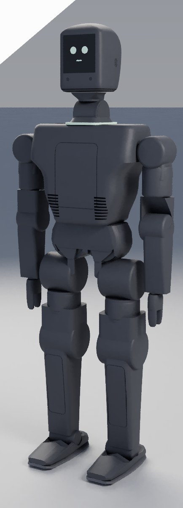
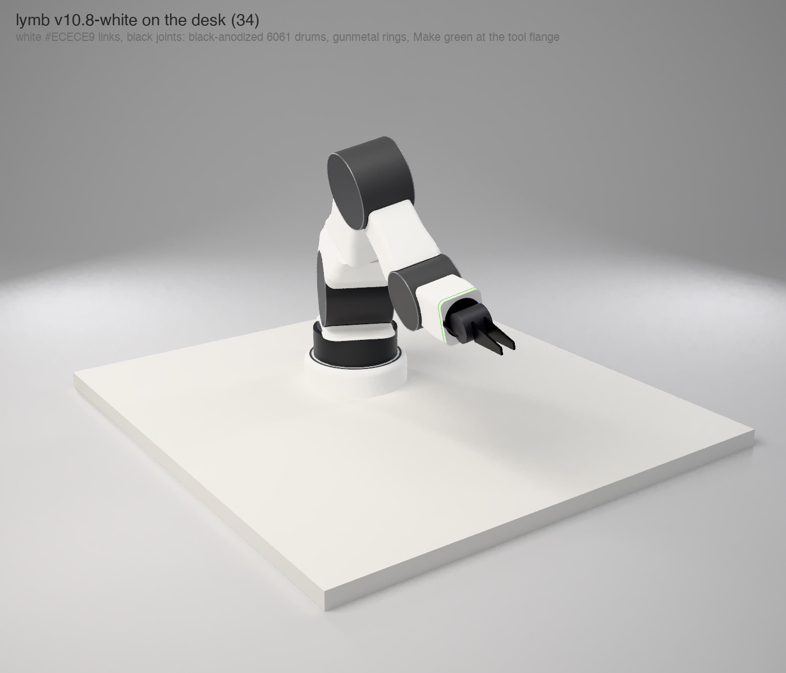
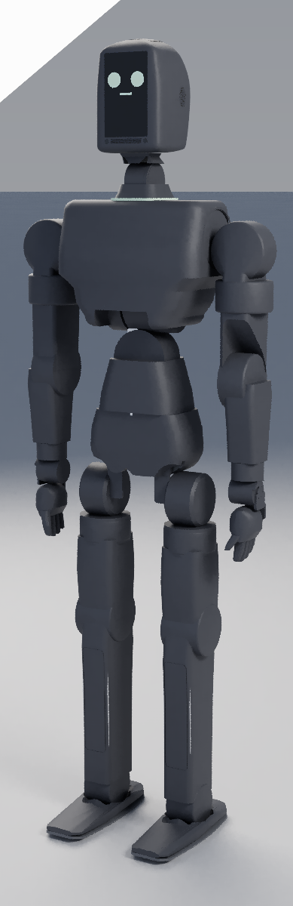

# rose

rose is Muni's humanoid robot line: three sizes (mini, full, mega) meant to share
one structure and one electronics stack. The name is the past tense of *rise*.

**State today: design stage.** This repository is CAD sources, sizing and checking
scripts, fabrication packages, PCB designs and renders. It records no built robot:
the fab packages say nothing has been ordered or cut
([`quad00/fab/README.md`](quad00/fab/README.md), [`arm/fork/V10.8.md`](arm/fork/V10.8.md)),
and every image here is a render
([`quad00/cortex/renders/release/README.md`](quad00/cortex/renders/release/README.md)).
Numbers are model outputs or vendor figures, not measurements, unless a file says
otherwise.

The repo is a working notebook, not a release. It holds several design passes
made between July and October 2026 that have not been reconciled with each other;
[Which design is current](#which-design-is-current) says how they relate. Muni's
overall plan, and where rose sits in it, is at <https://muni.works/research>.

| | |
|---|---|
|  |  |
| rose mini with the cortex head (`quad00/`, render) | the lymb arm, v10.8 (`arm/fork/`, render) |

## Repository layout

| path | what it is |
|---|---|
| [`family.py`](family.py) | The size ladder in one script: proportions, mass, static knee torque and a jump ceiling for mini / full / mega. |
| [`render.sh`](render.sh) | Re-renders the `mini/`, `full/` and `mega/` bodies with `vcad-render`. |
| [`mini/`](mini) | First mini: a 950 mm, 22-DOF sheet-metal study in vcad (July 2026). Superseded by `quad00/` as the working mini. |
| [`full/`](full) | rose full on MyActuator X-series: 1800 mm layout, bent-sheet "bones" under a polymer skin, generated plate by plate. Design notes in [`DESIGN.md`](full/DESIGN.md), [`SIZING.md`](full/SIZING.md), [`UNITREE.md`](full/UNITREE.md). |
| [`mega/`](mega) | rose mega on Muni's own rana actuators. Interfaces first ([`INTERFACES.md`](mega/INTERFACES.md)); the geometry in `cad/` is the earlier 1210 mm rose-1 study. |
| [`quad00/`](quad00) | Started as one leg of a RobStride quadruped, became the current mini humanoid (100 cm, 22 DoF, router-cut 3.2 mm plate, printed skins), a full-size variant in the same language, and the mega actuator sizing ([`MEGA-SIZING.md`](quad00/MEGA-SIZING.md)). Fab package in [`fab/`](quad00/fab). |
| [`quad00/cortex/`](quad00/cortex) | The cortex head: a detachable module with the compute, battery, cameras, mics and a screen face, which docks on the neck or sits on a desk. Spec in [`SPEC.md`](quad00/cortex/SPEC.md); the later "node" redesign in [`NODE-BRIEF.md`](quad00/cortex/NODE-BRIEF.md); print files in `print/` and [`../fab/node/`](quad00/fab/node). |
| [`arm/`](arm) | A RobStride table arm that is also rose's arm. `arm/` holds the first box design, [`arm/fork/`](arm/fork) the fork design that replaced it and its v10 revision ("lymb"), with fab and build packages. |
| [`arm/controller/`](arm/controller) | The limb controller PCB: schematic written in loon, exported to KiCad, routed ([`DESIGN.md`](arm/controller/DESIGN.md)). |
| [`brain/`](brain) | The brain board (RK3588S2 + STM32H7, split into compute module + carrier) and the three-board electronics plan ([`DESIGN.md`](brain/DESIGN.md)). Schematic and placement exist; routing and the pre-order checks listed in that file are open. |
| [`brand/`](brand) | Muni logo as SVG and KiCad footprints, for board art. |

Naming: `full` and `mega` were called `pro` and `max` until 2026-10-15. Some
files (and vcad's `hardware/rose-pro`) still use the old names.

## Which design is current

- **mini.** `quad00/` is the working model: the mini humanoid on RobStride
  actuators with the cortex head, frozen for a v1 fab package on 2026-10-20
  ([`quad00/fab/mini/STATUS.md`](quad00/fab/mini/STATUS.md), which also lists what
  is partial and what is left). `mini/` is the older 950 mm study on generic
  actuators.
- **full.** Two models exist. `full/` is the MyActuator X-series body at 1800 mm
  with the skeleton/skin split. `quad00/` also has a `full` variant on RobStride;
  its own source calls it "a packaging/kinematics/look model" because the largest
  RobStride is torque-short for the legs at that size
  ([`quad00/k1_structure.py`](quad00/k1_structure.py)).
- **mega.** Sizing only. [`quad00/MEGA-SIZING.md`](quad00/MEGA-SIZING.md)
  (2026-10-21, 1.95 m, estimates) is the latest; [`mega/`](mega) holds the earlier
  interfaces and the rose-1 geometry.
- **arm.** lymb v10.8 in `arm/fork/` ([`V10.8.md`](arm/fork/V10.8.md)). v9 is kept
  bit-identical and has the complete fab package.
- **head.** The cortex "node" v1.21 is the locked design for a first print
  ([`NODE-BRIEF.md`](quad00/cortex/NODE-BRIEF.md)).

The `family.py` ladder below (1200 / 1750 / 2000 mm, 22 DOF everywhere) is the
August sizing decision. The later passes do not all match it: `full/` was laid
out at 1800 mm, `quad00` mini is 100 cm, and the latest mega sizing is 1.95 m.

## Tools, and how to regenerate

Sources are Python generators and [loon](https://vcad.io) files. What you need
depends on the area:

- **Python 3** for every sizing and checking script. `quad00/` also needs
  `numpy trimesh manifold3d shapely ezdxf mapbox_earcut networkx lxml`
  (plus `rectpack` for `fab/make.py`).
- **[vcad](https://github.com/muni-works/vcad)** to evaluate and render `.loon`
  (`vcad`, `vcad-render`). `full/cad` imports its plate vocabulary from
  `hardware/rose-pro/plates.loon` in the vcad repo.
- **[phyz](https://github.com/muni-works/phyz)** for the arm simulation in `arm/sim`.
- **KiCad** (`kicad-cli`) for the two PCB flows.

Scripts assume sibling checkouts under `~/Developer` (see `render.sh`), and a few
files hold absolute paths from the author's machine. `*.step` files are in Git LFS.

```bash
# the size ladder
python3 family.py                      # proportions, mass, static holding, jump ceiling

# renders of mini/, full/, mega/ (needs vcad-render; full takes minutes on a cold cache)
./render.sh

# mini humanoid + cortex head (quad00)
cd quad00
python3 fab/make.py                    # plates (DXF), shells (STL), glass
sh cortex/export.sh                    # cortex.loon -> STEP / STL
python3 rom_mini.py                    # range of motion
python3 harness_check.py               # cable clearance
python3 vcad_export.py mini            # -> vcad/mini/mini.loon

# arm (run from the repo root)
python3 arm/fork/rose_fork.py --summary
python3 arm/fork/fork_checks.py        # mass, torque, stiffness
python3 arm/fork/audit.py              # interference, pinch points, joint ranges
python3 arm/fork/fab.py                # DXFs, nests, BOM -> arm/fork/fab/
(cd arm/sim && cargo run --release)    # phyz sim of the first (box) arm

# boards
./arm/controller/build.sh              # loon -> KiCad schematic, netcheck, ERC, PDF
./brain/build.sh
```

Each directory's README or design file has the full list for that area.
`python3 family.py --pack` (the actuator packing re-check) currently fails: it
calls into `full/`'s layout, whose interface changed when full was re-laid at
1800 mm.

## The line, as sized by family.py

Each height is anchored to something real and rounded to the nearest 50 mm.

| | height | mass | actuators | compute | anchor |
|---|---:|---:|---|---|---|
| [**rose mini**](mini) | 1200 mm | 18.0 kg | X6-60 / X4-36 / X4-10 | Orin NX | Booster K1 class (K1 is 1150) |
| [**rose full**](full) | 1750 mm | 55.5 kg *(est)* | X12 / X8 / X4-36 | Orin NX | a standard adult human |
| [**rose mega**](mega) | 2000 mm | 64.3 kg | rana-190 / -140 / -100 | Jetson AGX Thor | a lumberjack: taller *and* broader |

mega carries a ×1.15 bulk factor on top of the height scale, so it is broad
rather than merely tall: 305 mm stance against full's 232 mm.

The intended design language across all three is bent 3 mm 5052 sheet for the
primary structure (laser blanks, press brake, bolts), 22 DOF: 6 per leg, 4 per
arm, 2 in the neck. Proportions scale from rose full's first 1130 mm layout.

| | single-leg 90° squat (from `family.py`) |
|---|---|
| mini | 33 N·m needed at the knee, 60 available |
| full | 149 N·m needed, 320 available |
| mega | 197 N·m needed, 262 available; holds to 140° of knee bend |

Single leg is the case that matters. Two-legged standing halves the load, but
walking spends most of its time on one foot and every landing lands on one.

The current pass is in `quad00/`: mini and full in one design language, with the
cortex head (renders from 2026-10-28; mega has no render in this pass yet):

| | |
|---|---|
|  |  |
| **mini** (`quad00/renders/body-node/mini-34.png`) | **full** (`quad00/renders/body-node/full-34.png`) |

The older `mini/`, `full/` and `mega/` geometry has its own renders in each
folder's `render/`; those predate this pass.

### Actuator envelopes

When this table was sized, only four actuators had verified envelopes: X6-60,
X4-36, X4-10 (vendor STEP + the X-series V4 manual) and rana-100 rev D
(⌀100 × 44). For the larger ones `family.py` has torque but no dimensions, so
its packing check fails closed instead of inventing housings, and full's mass is
an estimate scaled from X6-60 by torque. `full/rose_full_layout.py` has since
taken X8 to X15 envelopes from vendor drawings for the 1800 mm layout; `family.py`
has not been updated to use them. rana-140 and rana-190 have no housing drawings
in this repo.

## What we learned sizing mega to jump

Unitree announced **Superman** on 17 Aug 2026: a claimed 2.0 m standing jump and
12.66 m/s top speed on 0.85 m legs and 360 N·m joints. Company demo, no independent
verification. Still, it is the number to design against, so [`family.py`](family.py)
puts vendor limits against it rather than picking a target by feel.

**rose mega is speed-limited, not torque-limited.** rana-190 has torque to spare
(the energy bound permits 0.65 m) but its 9.9 rad/s no-load output speed caps the
jump at **0.49 m**.

The reason is electrical, not mechanical. At peak current,

```
P = (Kt · I) · (V − I·R)/Kt = I · (V − I·R)
```

**Kt cancels.** Every actuator in the rana family delivers the same 1.3 kW peak
mechanical power, because peak power is set by the bus and the current limit alone
(48 V × 30 A), and gearing only trades torque against speed inside that envelope:

| | Kt | output torque | no-load speed | peak mech |
|---|---:|---:|---:|---:|
| rana-100 | 0.1657 | 36 N·m | 36.2 rad/s | 1.30 kW |
| rana-140 | 0.3326 | 96 N·m | 18.0 rad/s | 1.30 kW |
| rana-190 | 0.6055 | 262 N·m | 9.9 rad/s | 1.30 kW |

The ladder from rana-100 to rana-190 is a *torque* ladder, not a *power* ladder.
So jump height on this machine is an electrical spec:

| target | takeoff | knee rate | knee torque | both knees | vs available |
|---:|---:|---:|---:|---:|---:|
| 0.3 m | 2.43 m/s | 7.8 rad/s | 213 N·m | 3.3 kW | 1.3× |
| 0.5 m | 3.13 m/s | 10.0 rad/s | 289 N·m | 5.8 kW | 2.2× |
| 1.0 m | 4.43 m/s | 14.2 rad/s | 479 N·m | 13.6 kW | 5.2× |
| 2.0 m | 6.26 m/s | 20.0 rad/s | 860 N·m | 34.4 kW | 13.2× |

The levers are bus voltage and current, or series elastics that let the motors
work slowly and release fast. A bigger rana is not one of them.

## Limits

- **Nothing here has been validated on hardware.** Masses are budgets, torques
  are quasi-static, thermal figures come from lumped models. Several interface
  dimensions are marked ASSUMED in their files (RS06 bolt patterns in
  `quad00/quad.py`, parts of the cortex stack in
  [`quad00/CORTEX.md`](quad00/CORTEX.md)); the bench measurements still to take are
  listed in [`quad00/fab/MEASURE.md`](quad00/fab/MEASURE.md).
- **The rana actuators that mega depends on are not built**
  ([`quad00/MEGA-SIZING.md`](quad00/MEGA-SIZING.md)). The rana figures above are
  design values.
- **The jump model** is planar, knee-dominated and first-order: vendor limits in,
  a number out, no controller search. It ignores the hip and ankle contributions
  that would raise it and the transmission losses that would lower it. Both bounds
  it reports are ceilings.
- **The static check is one pass, not a fixed point.** A heavier actuator makes
  the robot heavier, which raises the torque it has to hold. Treat a marginal
  pass as marginal.
- **The packing check** compares actuator body against actuator body only
  (plates, fasteners and harness are not in it), and does not currently run.
- **The fab packages are not final.** The mini's printed skins are generated,
  not designed, and its BOM is partly unpriced
  ([`STATUS.md`](quad00/fab/mini/STATUS.md)); the arm's order lists are parked
  pending design approval.
- **Reference robots.** Comparison renders of the Unitree G1 / H2 and Booster K1
  are made from those vendors' published URDFs and meshes; see
  [`full/reference/README.md`](full/reference/README.md) and `quad00/k1.py`.

## Used elsewhere

The vcad paper [*Exact Gradients Through a BRep Kernel*](https://muni.works/research/vcad)
and the [irys](https://github.com/muni-works/irys) renderer share a benchmark
built on one part from this repo: rose full's left shoulder-pitch output plate,
`L_shoA_shop_out` in [`full/cad/links/shoA.loon`](full/cad/links/shoA.loon).
irys's `rose_brep` example reads it at commit `832192f`; the file has changed
since, so check out that commit to reproduce the benchmark.
