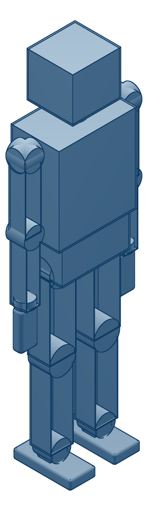
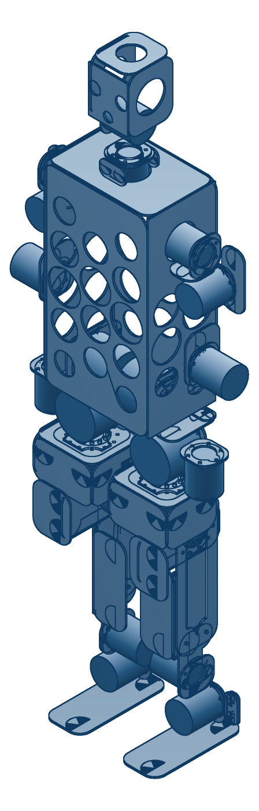
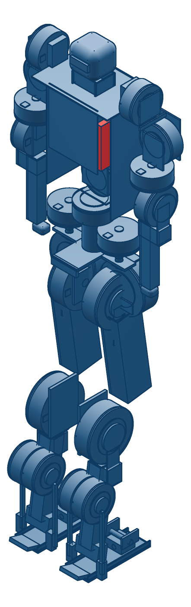

# rose

Our humanoid. The name is the thesis: past tense of *rise* — the one that stood up.

Third machine of the pond: **rana** (actuators) → **frog** (quadruped testbed) →
**rose**. frog is the crash-test vehicle; rose's falls are expensive, so the
control stack arrives here already debugged.

## The line

Each height is anchored to something real and rounded to the nearest 50 mm.

| | height | mass | actuators | compute | anchor |
|---|---:|---:|---|---|---|
| [**rose mini**](mini) | 1200 mm | 18.0 kg | X6-60 / X4-36 / X4-10 | Orin NX | Booster K1 class (K1 is 1150) |
| [**rose pro**](pro) | 1750 mm | 55.5 kg *(est)* | X12 / X8 / X4-36 | Orin NX | a standard adult human |
| [**rose max**](max) | 2000 mm | 64.3 kg | rana-190 / -140 / -100 | **Jetson AGX Thor** | a lumberjack — taller *and* broader |

max carries a **×1.15 bulk factor** on top of the height scale, so it is broad
rather than merely tall: 305 mm stance against pro's 232 mm, and structure that
goes as `length³ × bulk²`. A lumberjack is not a tall thin person.

One design language across all three: **bent 3 mm 5052 sheet** primary structure
(laser blanks + press brake + bolts, no angle stock and no machined blocks),
exposed-skeleton limbs against a shaped torso that *is* the structure, staggered
and graded lightening cutouts, and contact geometry on the feet only. 22 DOF
everywhere — 6 per leg, 4 per arm, 2 in the neck.

Proportions scale from rose pro's **verified** 1130 mm layout, which stands in
`phyz` at **+0.0 %** ground-force error with COM→COP 0.6 mm.

```bash
python3 family.py           # proportions, mass, static holding, jump ceiling
python3 family.py --pack    # + re-run the packing check on each scaled skeleton
./render.sh                 # re-render all three from the geometry in this repo
```

## As they exist today

These are renders of the **geometry actually in this repo**, not of the sizes in
the table above. Each is at whatever height its CAD was authored at — mini 1150,
pro 1130, max ~1750 — because the 1200/1750/2000 ladder is a sizing decision that
the geometry has not been re-cut to yet.

| | | |
|---|---|---|
|  |  |  |
| **mini** — massed volumes, 22 DOF, sheet torso and a cube head. The oldest geometry here. | **pro** — thighs and shanks are now channels that *wrap* their actuators, knee 55 mm back like the G1's; the head as an open cage. 49 bent plates. Arms still sticks. | **max** — full actuator detail, pancake rana bodies, pushrod ankle four-bar, battery in red. |

What the three renders show, side by side, is that the *design language* is not
yet shared: mini is massed volumes, pro is cut sheet, max is detailed mechanism.
Bringing mini and max into pro's bent-sheet language is exactly the open work.

## Where each one stands

| | single-leg 90° squat | packing check |
|---|---|---|
| mini | 33 N·m needed, 60 available — torque never binds at any angle | **PASS**, tightest +8.7 mm |
| pro | 149 N·m needed, 320 available — holds full range | **BLOCKED** |
| max | 197 N·m needed, 262 available — holds to 140° of bend | **BLOCKED** |

Single leg is the case that matters. Two-legged standing halves the load, but
walking spends most of its time on one foot and every landing lands on one.

**mini** — the only variant that is geometrically verified end to end. Was `toad`,
a separate 950 mm design on generic A/B/C actuator SKUs; that geometry is
superseded, and what survives is in [`mini/`](mini) — the vcad kinematic tree, DFM
pass and actuator sizing.

**pro** — growing 1130 → 1750 mm broke the actuator selection, which is the useful
thing this pass found. **X6-60 cannot hold a single-leg squat at 1750 mm**: it needs
149 N·m and has 60, so it runs out at about 67° of knee bend — enough for walking
stance, not for squatting, landing or jumping. The fix is X12 knees and X8 ankles,
and it is expensive: actuator mass goes 11.4 → 37.8 kg and the robot roughly
doubles to ~55 kg.

**max** — 2000 mm, 64.3 kg, rana-190 hips and knees, rana-140 ankles, rana-100 arms,
1.2 kWh at 48 V, Jetson AGX Thor. Pre-geometry: [`max/INTERFACES.md`](max/INTERFACES.md)
is deliberately the first artifact, and geometry starts only against frozen interfaces.

### Why two of the three say BLOCKED

Moving pro and max onto bigger actuators cost us the packing check, and that is
worth stating plainly rather than burying. Only four actuators have verified
envelopes: **X6-60, X4-36, X4-10** (vendor STEP + the X-series V4 manual) and
**rana-100 rev D** (⌀100 × 44). For X8, X12, X15, rana-140 and rana-190 the vendor
or our own design log gives *torque* but no dimensions, so `--pack` fails closed
instead of inventing housings.

Unblocking is concrete: pull vendor STEP for X8/X12, and produce housing drawings
for rana-140/190. Until then, pro's and max's masses are estimates too — the X8/X12
figures are scaled from X6-60 by torque, not measured.

## What we learned sizing max to jump

Unitree announced **Superman** on 17 Aug 2026 — a claimed 2.0 m standing jump and
12.66 m/s top speed on 0.85 m legs and 360 N·m joints. Company demo, no independent
verification, no hands, and it crashed into an electrical box in the video. Still,
it is the number to design against, so [`family.py`](family.py) puts vendor limits
against it rather than picking a target by feel.

The result is not the one we expected. **rose max is speed-limited, not
torque-limited.** rana-190 has torque to spare — the energy bound permits 0.65 m —
but its 9.9 rad/s no-load output speed caps the jump at **0.49 m**.

And the reason is electrical, not mechanical. At peak current,

```
P = (Kt · I) · (V − I·R)/Kt = I · (V − I·R)
```

**Kt cancels.** Every actuator in the rana family delivers the same 1.3 kW peak
mechanical power, because peak power is set by the bus and the current limit alone
— 48 V × 30 A — and gearing only trades torque against speed inside that envelope:

| | Kt | output torque | no-load speed | peak mech |
|---|---:|---:|---:|---:|
| rana-100 | 0.1657 | 36 N·m | 36.2 rad/s | 1.30 kW |
| rana-140 | 0.3326 | 96 N·m | 18.0 rad/s | 1.30 kW |
| rana-190 | 0.6055 | 262 N·m | 9.9 rad/s | 1.30 kW |

The ladder from rana-100 to rana-190 is a *torque* ladder, not a *power* ladder.
So jump height on this machine is an electrical spec:

| target | takeoff | knee rate | knee torque | both knees | vs available |
|---:|---:|---:|---:|---:|---:|
| 0.3 m | 2.43 m/s | 7.8 rad/s | 213 N·m | 3.3 kW | 1.3× |
| 0.5 m | 3.13 m/s | 10.0 rad/s | 289 N·m | 5.8 kW | 2.2× |
| 1.0 m | 4.43 m/s | 14.2 rad/s | 479 N·m | 13.6 kW | 5.2× |
| 2.0 m | 6.26 m/s | 20.0 rad/s | 860 N·m | 34.4 kW | 13.2× |

Three levers, and a bigger rana is not one of them: a **100 V / 60 A leg drive**
gets you to 1 m, a **150 V / 120 A** one to 2 m, or **series elastics** let the
motors work slowly and release fast — the only lever that beats the V·I ceiling
instead of paying for it, and how every good biological and robotic jumper does it.

Worth noting what this says about Superman: 360 N·m at ~21 rad/s is ~7.5 kW *per
knee*, roughly 6× a rana-190. Their actuators are power-dense where ours are
torque-dense. That is a design choice we have not made yet, and now we know it is
the choice that matters.

## Honest limits on the above

The jump model is planar, knee-dominated, and first-order — vendor limits in, a
number out, no controller search, in the same spirit as the ollie feasibility work.
It ignores the hip and ankle contributions that would raise it and the transmission
losses that would lower it. Both bounds it reports are *ceilings*: the real machine
lands under the lower one.

The static check is **one pass, not a fixed point** — a heavier actuator makes the
robot heavier, which raises the torque it has to hold. Treat a marginal PASS as
marginal.

The packing check is real — it re-runs pro's own sampled-surface clearance test on
each scaled skeleton, and it needed running rather than assuming, because actuator
bodies stay the same size while the skeleton grows and the near-tangent hip
yaw↔knee gap has moved the *wrong* way under a length increase before. But it
compares *actuator body against actuator body only*: plates, fasteners and harness
are not in it.
