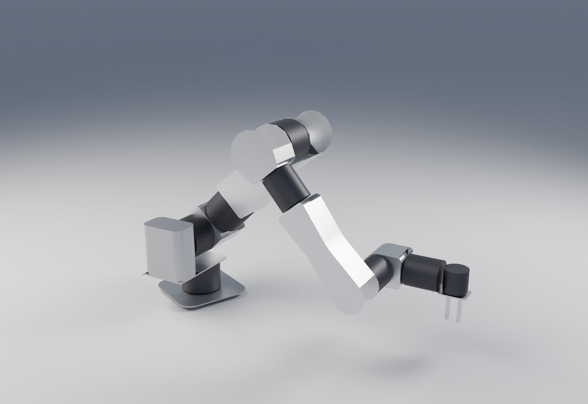

# rose arm — a RobStride table arm that is also rose's arm

7 DOF + gripper on RobStride integrated actuators, structure in **flat** 5052
cut on the Anolex 4040. No press brake. Sold as a table arm; laid out as a
humanoid arm. The reBot B601-RS is the reference to beat.

```bash
python3 arm/rose_arm_layout.py      # links, mass, torque, stiffness, clearance, fold limit, cut list, BOM
python3 arm/rose_arm_loon.py        # -> cad/rose-arm.loon
python3 arm/rose_arm_export.py      # -> sim/*.urdf, sim/rose_arm_params.json, cad/rose-arm-assembly.loon
(cd arm/sim && cargo run --release) # phyz: hold, power cut, reach, roll, duty sweep -> sim/out/
```



## Architecture: links never overlap

Each pancake is the node. Its stator bolts to one box, its output to the next,
so the only moving interface between two links is the actuator's own output
circumference — a gap nothing fits in. Pitch pancakes stand **beside** the
boxes (offset elbow, the UR / G1 pattern). Roll pancakes sit **inline** as drums
between two box segments, the box sized to the drum so link and joint read as
one body.

The first cut was open U channels with the forearm riding inside the upper-arm
channel. That was a scissor through the whole elbow range and had no torsional
stiffness. Closed boxes fix both.

Links are **closed boxes of flat plates**, tab-and-slot: 1.5 mm skins with 30 %
windows, plus a 3 mm doubler riveted inside each wall under a bolt circle. The
roll drums split every link into short boxes, so every plate fits the 4040.

## The look (2026-10-12, third cut)

Each link side is a profile, not a rectangle. An end that meets a pitch motor
is a round lobe concentric with it, so the motor disc sits in a cradle of its
own radius. An end that meets a roll drum is flat at the drum's height. Long
segments waist to 72 % of their smaller end mid-span, where bending is lowest.
Tapers run tangent into the lobes, the waist is a 120 mm curve, and every
corner where a link meets a roll drum has an 8 mm radius. Base plate, column
and gripper plate are plan-rounded. All of it is 2D - the profile outline -
so it costs nothing on the router. The long edges along each link are still
square: vcad's 3D fillet drops sketch-extruded solids (tested 2026-10-12), and
the real answer is a kerf-bent wrap strip, which needs a test coupon first.
Still flat sheet: two profile plates plus one wrap strip per segment. Mass fell
6.2 → 5.8 kg; flange sag 0.43 mm (conservative: waist section assumed over the
whole span).

## Numbers (2026-10-12, boxes - superseded by the tapered cut above for mass)

| | rose arm 7-DOF | reBot B601-RS |
|---|---:|---:|
| DOF | 7 + gripper | 6 + gripper |
| reach from shoulder | 798 mm | 754 mm |
| payload | 2.5 kg | 2.5 kg |
| mass | 6.2 kg | 6.7 kg |
| structural deflection at the flange | 0.2 mm sag, 0.2 mm twist | — |
| motors | RS06 ×4, RS00 ×3, EduLite ×1 | RS06 ×3, RS00 ×4 |
| motors at amazon retail | $1,645 | ~$1,440 |
| plates | 51, all flat, all under 390 mm | sheet + prints |
| moving-link overlap | none | — |

Skin thickness sweep (7-DOF): 2.0 mm → 6.6 kg / 0.15 mm, **1.5 → 6.2 / 0.21**,
1.2 → 6.0 / 0.27, 1.0 → 5.8 / 0.33. Structure stays under the actuators'
own backlash down to 1.2 mm; 1.5 is chosen for tab bearing and window buckling.

## The shoulder needs the spring

Shoulder pitch at full reach with 2.5 kg is **37 N·m against an RS06's 36
peak** — the arm cannot hold its rated payload bare. A gas spring across J2
cancels the self-weight moment (~295 N at 60 mm) and the shoulder sees
19.6 N·m, SF 1.8. Payload at full reach for SF 1.5: 0.8 kg bare, 3.1 kg with
the spring. The spring is not yet placed: it has to live **inside** the column
or the upper-arm box, never in free air, or it is the pinch point.

## Sim (phyz, 2026-10-12)

`sim/` loads the exported URDF with phyz-urdf and runs it at 4 kHz. Motors are
torque sources on a linear torque-speed line from RobStride peak to no-load.
The controller is PD plus RNEA gravity feed-forward. The J2 gas spring is a
passive force from its real anchor geometry, so it is imperfect off horizontal.
Static hold matches the hand calc: 19.7 N·m simulated vs 19.6 predicted.

| test | spring | no spring |
|---|---|---|
| hold 2.5 kg straight out | 19.7 N·m, 55 % of peak | saturates at 36 for the whole hold, sags 2.7 mm |
| reach and return, 2.5 kg | 64 % peak, 0.6° worst error | shoulder saturated 1.6 s of 3, flange sags 150 mm off path |
| power cut, phases open | elbow slams to its stop in 0.24 s, shoulder flung up | whole arm falls, 5.2 m/s at the flange |
| power cut, phases shorted | **glides, 0.9 m/s peak, settles** | falls at 2.8 m/s |

**Continuous payload is about 1.5 kg, not 2.5.** On a reach-and-return every
3 s, RMS torque reaches the rated torque at 1.5 kg on both the shoulder and the
elbow. 2.5 kg runs the shoulder at 1.66× rated, which is a thermal clock. reBot
quotes 2.5 kg on the same motors with no spring; the same physics applies.

**The spring alone is not a failsafe.** With phases open it holds the shoulder
but the elbow folds, and the now-overbalanced shoulder throws the folded arm
upward. Spring plus shorted phases is the only gentle power loss. Whether
RobStride's driver shorts phases on fault is unconfirmed, and the shorted-phase
damping uses estimated Kt and phase resistance.

Not modelled: self-collision, the table, gear backlash, motor thermal model
(RMS against rated is the proxy). Rotor inertia, joint friction and shorted-phase
damping are estimates, marked in `rose_arm_export.py`.

## Joints

| joint | motor | why |
|---|---|---|
| J1 base yaw | RS06 | no gravity moment; carries the arm's bending moment on its output bearing |
| J2 shoulder pitch | RS06 + gas spring | governs |
| J3 upper-arm roll | RS06 | elbow bent 90°, it carries the forearm + payload moment |
| J4 elbow | RS06 | 17 N·m, SF 2.1 |
| J5 forearm roll | RS00 | 5 N·m, SF 2.8 |
| J6 wrist pitch | RS00 | 5 N·m, SF 2.8 |
| J7 tool roll | RS00 | |
| gripper | EduLite 05 | parallel jaw (to design) |

Elbow folds to 160° before the hand meets the upper-arm roll drum.

## Costs of this layout

- **The offsets make it wide.** The forearm box sits 133 mm to the side of the
  upper arm, the hand comes back to +34. Top view is a zig-zag, ~260 mm across.
  That offset is also a lever that twists the upper arm in the zero pose.
- **6-DOF variant** needs a splice: its upper-arm box is 420 mm, over the bed.
- **Router, not laser.** Inside corners need dogbones; 1.5 mm sheet needs real
  workholding. Bed size assumed 390 mm usable — confirm on the machine.

## Open

- confirm RobStride fault behaviour: do the drivers short phases on power loss / fault?
- spring rebalance: size it so the folded arm is not overbalanced, or add an elbow spring
- rate the product at ~1.5 kg continuous / 2.5 kg peak, or move the shoulder to an RS04
- gas spring placement, inside a box
- real plates: tabs, slots, windows, doublers, RobStride bolt circles from the STEP
- 4th axis: turned spacers between pitch outputs and the next box, and the yaw bearing housing
- RobStride direct pricing. reBot's early bird is within $60 of amazon motor cost.
- gripper, flange, wrist camera
- MJCF (URDF exists: sim/rose_arm.urdf)
