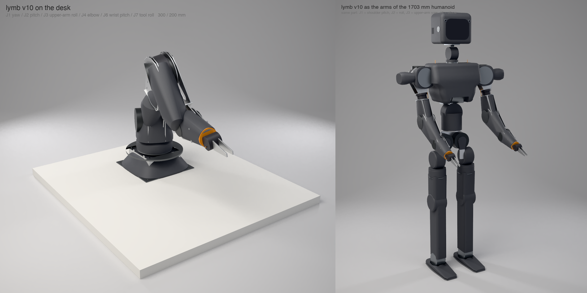

# Lymb v10: redesign for Cam's review (one page)

**Asking for:** approve v10 as the one arm for the desk and the humanoid, plus one decision on J3 (below). Design only; nothing is ordered, and the full order list stays parked. All numbers are model outputs (`numbers_v10.py`); none is measured.

More renders: [desk](render/lymb-v10-desk.png), [humanoid](render/lymb-v10-humanoid.png), [v9 vs v10, bare](render/lymb-v9-vs-v10-desk.png).

## What changed vs v9, and why
1. **The roll joint moved from the forearm to the upper arm (J5 → J3).** It is an RS02 cartridge 105 mm past the shoulder.
   - On the humanoid, the same unit's chain (J1 shoulder pitch, J2 roll, J3 upper-arm yaw, J4 elbow) is exactly the H2-style pitch-roll-yaw-elbow, with the elbow bending forward.
   - It uses the same six motors (RS04 ×3, RS02 ×2, RS00) at the same cost.
2. **Proportions are 300 / 200 mm** (v9: 260 / 220), toward the 1703 mm humanoid's 318 mm shoulder-to-elbow.
3. **The mount is the only part that differs.**
   - The turret is as short as the RS04 lobe allows: 126 mm from the J1 back face.
   - **Desk:** a 68 mm pedestal tube keeps J2 at 200 mm over the table.
   - **Humanoid:** a 36 mm chest adapter lands J2 at |y| = 255 mm, the humanoid's shoulder-roll axis.
4. **Exterior:** the humanoid's skin language. Lofted satin-black shells over the plate frame, flush graphite pucks at J2, J4 and J6, gunmetal rings at J1 and J3. The skin is printed covers only; the plates stay the structure.
5. **Fixes the checks forced:** two plate webs widened, and a +20° J2 stop so the upper arm clears the turret disc.

## Numbers

| | v9 | v10 |
|---|---:|---:|
| mass | 8.34 kg | 8.88 kg desk (pedestal 0.61 kg), 8.27 kg body |
| reach, J2 to jaw tips (with gripper v2) | 732 (787) mm | 752 (807) mm |
| hold straight out, model jaws / gripper v2 | 1.44 / 1.05 kg (wrist) | 1.37 / 1.05 kg (J2 1.37 / 1.11, J6 1.44 / 1.05) |
| sag / twist (budget 0.5 / 0.5 mm) | 0.13 / 0.10 mm | 0.32 / 0.14 mm |
| ranges: J2 / J4 / wrist | −180..40 / −120..115 / ±135° | −180..20 / −150..125 / ±120° |
| interference, ~207 poses / DFM issues | none / 0 | none / 0 |
| router parts (unique), 1/8" sheets | 23 (20), 3 + one 1/4" | 31 (26), 4 + one 1/4" desk; 3 + one 1/4" body |
| per-arm materials (reseller prices) | ~$2,180 | ~$2,230 (+ pedestal plates, 1 sheet) |

## Risks
1. **J3 is weak in one kind of pose.** With the upper arm level and the forearm swung out sideways, J3 carries the elbow's load: 14.8 N·m at 2.5 kg, under the RS02's 17 N·m peak but about 3× its continuous rating. In the worst pose it holds 0.15 kg (with model jaws).
   - On the desk, poses with the forearm in the J2 plane don't load J3.
   - The humanoid's sideways "tray" poses do load it.
2. **The 1.27 kg payload claim doesn't hold with gripper v2 in this model, on v9 or on v10.** Gripper v2 gives 1.05–1.19 kg, against the paper's 1.27 kg.
   - The gripper here is modelled as 485 g lumped 50 mm past the J7 output.
   - Either the paper's number or this model is off. The elbow rig's 25 N·m heat test settles the shoulder side of it.
3. **Sag roughly doubles, to 0.32 mm,** from the extra joint in the upper arm. The figure assumes a rigid J3 bearing; RobStride publishes no moment stiffness for it.
4. **Humanoid fit:**
   - J1 stands 36 mm proud of the chest shell, so the chest needs a socket.
   - The +20° J2 stop (adduction) isn't checked against the torso.
   - The skin shells overlap at the joints, with no clash check yet.

## Decision for Cam: J3
- **(a) Keep the RS02 and cap loaded sideways poses in software.** Cheapest, and the desk numbers don't change. I recommend this for the first build: the elbow rig tests the J2/J4 joint first, and J3 is only loaded in poses the desk doesn't need.
- **(b) Put an RS04 at J3.** About +$120 and about +1 kg near the shoulder, which costs roughly 0.1 kg of J2 hold. Fixes the humanoid's tray poses.

## Requirements Desk doesn't need (unchanged from the v9 review)
- gripper v2
- the roll-joint clock-spring cassettes
- cosmetic covers for the first measured article
- mini and mega
- the duet plate and hub

The humanoid skin is for the product and the paper's renders. The first measured lymb can be built bare.

Model: `ROSE_ARM=v10` in `rose_fork.py`; v9 is unchanged when it's unset. Fab package: `fab-v10/`. Details: [V10.md](V10.md).
