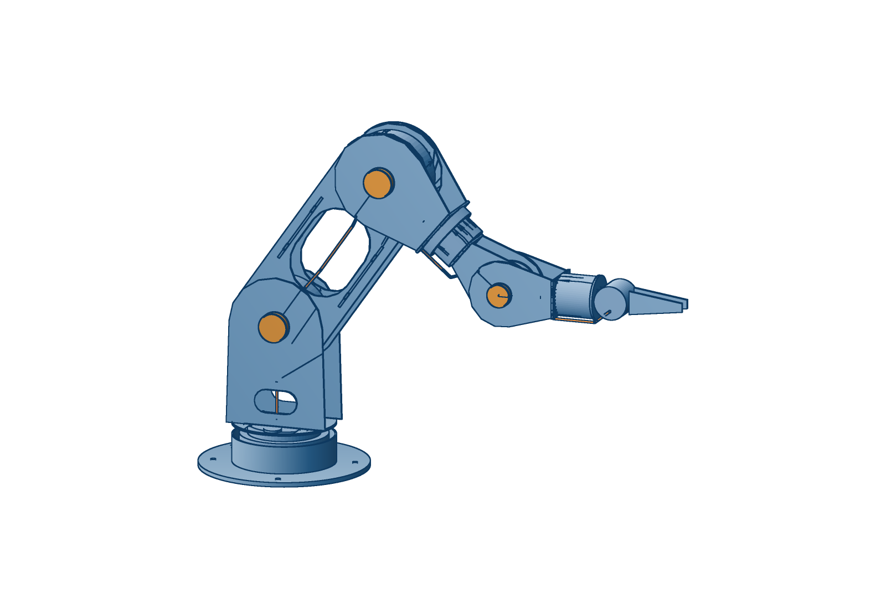
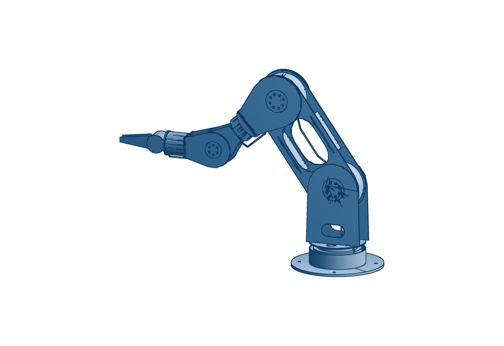

# Lymb (Rose fork v9): design review for Cam's approval

**Asking for:** approve, change, or reject the design below. Nothing is ordered until you approve. Numbers come from the model (`fork_checks.py`, `audit.py`, `dfm.py`, re-run 2026-10-20); none has been measured.

 
Motion: [fork-v9-motion.mp4](../render/fork-v9-motion.mp4)

## Architecture
- **Every pitch joint is a fork.** The parent holds the motor between two side plates. The child straddles it: one plate bolts to the output, the other rides a plain bushing on a hollow sleeve on the same axis. There are no offsets.
- **Cables run through the sleeves,** so at pitch joints they only twist. At the roll joints they will run in clock-spring cassettes, which are not designed yet.
- **Every motor is mounted by its back face.** The two roll joints are cartridges on cross plates.
- **Structure:** every plate is flat 1/8" 5052 sheet except the 1/4" foot, located by tabs and slots. There are 20 unique router parts, nested on three 1/8" sheets and one 1/4" sheet for the 4040. Three turned 6061 sleeves complete it.

## Key dimensions
| | |
|---|---|
| shoulder height over the foot | 200 mm |
| upper arm / forearm | 260 / 220 mm |
| jaw tips from the shoulder | 731 mm (786 with gripper v2) |
| foot | Ø230, 4 x M6 on Ø190 |
| tool flange | Ø61, 6 x M3 on Ø27 |
| mass | 8.34 kg (paper says 8.21; the model has grown since) |

## Actuators
| joint | motor | why |
|---|---|---|
| J1 base yaw | RS04 | carries the whole tipping moment; the same part as J2 and J4 |
| J2 shoulder | RS04 | sets payload; an RS02 cannot hold the arm at any length |
| J4 elbow | RS04 | 4.46 kg of headroom; an RS02 would save ~$100 and 0.9 kg, at the cost of payload |
| J5 forearm roll | RS02 | cartridge |
| J6 wrist pitch | RS02 | binds together with the shoulder (1.44 kg) |
| J7 tool roll | RS00 | cartridge |
RS03 is not sold. Three motor models in total.

## Predicted vs requirement
| | predicted | requirement / claim | status |
|---|---:|---:|---|
| reach | 731 mm (786 with gripper) | 786 mm (paper) | meets, modeled |
| continuous hold, straight out | 1.44 kg (wrist), 1.46 kg (shoulder), arm-model jaws | 1.27 kg with gripper v2 | meets, about 13 % margin; heat-limited |
| sag / twist at the flange | 0.13 / 0.10 mm (structure only) | 0.5 / 0.5 mm budget | meets; gearbox compliance not modeled |
| tool-point error | not predicted | ≤ 2.0 mm RMS, 50 poses, 0 and 1 kg | **unknown until built** |
| interference, 209 poses | none | none | meets |
| elbow / wrist range | −120…115° / ±135° | n/a | |

## Cost, one arm (reseller prices researched 2026-10-20; most non-motor lines are estimates)
| | $ |
|---|---:|
| motors: RS04 x3 $885, RS02 x2 $350, RS00 $152, shipping ~$67 | ~1,455 |
| gripper motor EL05 (identity unconfirmed) | 82 |
| CAN adapters, 48 V supply, e-stop | ~175 |
| metal, bushings, rings, screws, harness, connectors, adhesives | ~470 |
| **per-arm materials** | **~2,180** |
| one-off tools and measurement kit (end mills, indicator, probe, weights, level, cal plate) | ~300 |
The paper assumes ~$2,000, with ~$1,200 for motors. At reseller prices the motors are ~$1,455. RobStride's factory list (¥1,199 per RS04 ≈ $168) would bring them under $1,100. Get a direct quote before selling 10.

## Open risks
1. **Every motor is backordered:** 4–6 weeks, or 10–20 working days from OpenELAB. That alone sets the schedule.
2. **The 2.0 mm gate is unproven.** It depends on encoder zeros, plate tolerance and the bushing play at each fork. Nothing has been measured; the elbow rig would test it on one joint first.
3. **RS02 thread depths are assumed at 6 mm.** Measure them before buying screws.
4. **Heat sets the hold rating, at 13 % margin.** The RS04 continuous rating assumes a 220 x 200 mm heat sink; our plates may be worse.
5. **Power-off behaviour is undocumented.** It is unknown whether an unpowered arm falls, and the crush points have no policy yet (soft limits or force limiting).
6. **The roll-joint cable cassettes are not designed.** The yoke bridge passes about 1 mm from the RS02 nose; check it on a real part.

## What I'd change before cutting
- **Build the first one as a measurement article.** Fit a probe flange, no gripper, service loops instead of cassettes, and no cosmetic covers or caps.
- **Prove the joint on the elbow rig first.** It needs one RS04, ~$530 and one week. It answers fork play, sag, heat and power-off before the other five motors are committed.
- **Decide on J5.** A 5-DOF arm drops an RS02, ~0.5 kg at the wrist and a cassette, and raises the hold. Keep J5 only if a named Desk task needs it.

## Requirements I think Desk doesn't need (yet)
1. **Gripper v2 / EL05.** It isn't needed to measure or rate the arm.
2. **Clock-spring roll cassettes.** Service loops and ±170° software limits do for a first build.
3. **The cortex exterior language on the covers.** It's cosmetic and can be added later without taking the arm apart.
4. **The mini and mega sizes.** Desk step 2 sells lymb full only.
5. **J5 forearm roll.** See above.
6. **Duet plate and hub.** Desk step 2 is one arm.

Full build package (assembly order, measurement protocol, scripts): [BUILD.md](BUILD.md). The order list is parked: [ORDER.md](ORDER.md).
