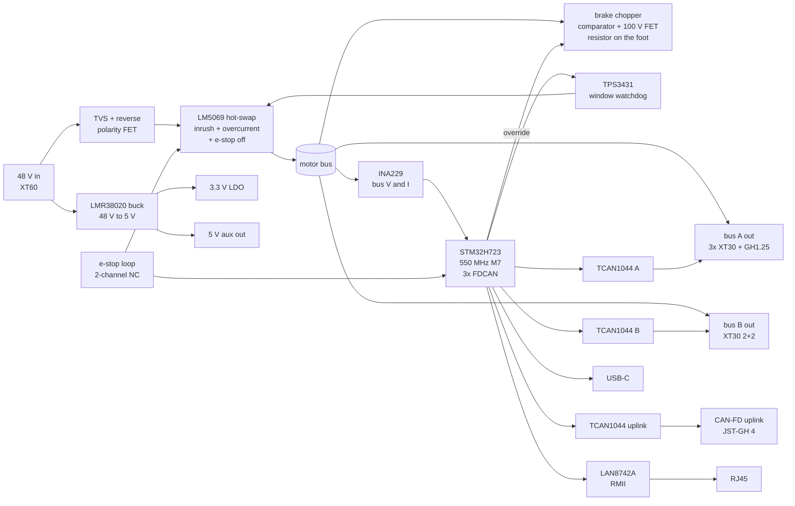

# Arm controller board - design v0.1 (2026-10-13)

**Schematic:** `arm_controller.loon` is the circuit, written in loon, and it is the source.
`./build.sh` exports it with vcad to `arm_controller.kicad_sch`. It then checks that every pin is
on its loon net with no merges (`netcheck.py`), runs KiCad ERC (0 errors), and plots
`arm_controller.pdf`. Every part is a KiCad library symbol, so pin numbers come from KiCad.

**Parts the schematic uses instead of the first pass below.** Each change was made to use a part
that KiCad's library has:

| first pass | schematic | why |
|---|---|---|
| TCAN1044 | MCP2562FD | same role, 8-pin CAN-FD, in KiCad's library |
| LM5069 | LM5060 | high-side switch controller with enable, inrush and VDS overcurrent |
| INA229 (SPI) | INA228 (I2C) | same 85 V, 20-bit monitor |
| TPS3431 | TPS3430 | same window watchdog family |
| LMR38020 to 5 V | LM5164 48 V to 12 V, then TPS54302 to 5 V | the 12 V rail drives the brake FET gate and feeds aux |
| FDCAN2 on PB12/PB13 | FDCAN2 on PB5/PB6 | the 100-pin package has no port G, so RMII takes PB11-PB13 |

- **Same FET twice.** The hot-swap and brake FETs are the same 100 V TOLL part.
- **VCAP pins.** The two VCAP pins each get their own 2.2 µF capacitor.
- **Footprint gap.** KiCad has no XT30(2+2) footprint, so the wrist-bus connector is a marked
  placeholder until one is drawn.
- **Check before layout.** Verify the FDCAN3 pins (PD12/PD13) and every alternate-function
  assignment in CubeMX.

One board per arm. It sits in the base, on the 6 mm foot, beside the yaw motor. It replaces
four boxes:

| replaced | by |
|---|---|
| RobStride Power Board | the power front end: inrush limit, e-stop switch, bus monitoring |
| RobStride Discharge Module | the on-board brake chopper; its resistor is bolted to the foot |
| a USB-to-CAN adapter | two motor buses, driven directly by the microcontroller |
| a Teensy + transceivers | the microcontroller, with a hardware watchdog it can't override |

It has two firmware modes on the same hardware:

- **Robot mode.** A humanoid's main computer sends joint targets each tick: position, velocity,
  kp, kd and feed-forward torque. The board forwards them to both buses in the same tick and
  returns the motor states. It does no kinematics. It adds the safety layer and one cable across
  the shoulder.
- **Standalone mode.** A laptop talks to the board over USB-C or Ethernet. The board runs the
  servo loop, trajectory interpolation, gravity compensation and the safety policy. The user needs
  no CAN adapter and no realtime OS.

## Requirements

Facts below come from the RobStride manuals in `~/Developer/robstride_assets`.

| | requirement | source |
|---|---|---|
| bus voltage | 48 V nominal; every part on the bus rated 80 V or more | motors 15–60 V; regen spikes |
| motor buses | 2, CAN 2.0 at 1 Mbps today; CAN-FD capable for later | motors default to 1 Mbps CAN 2.0; most RS models list CAN-FD |
| control rate | 1 kHz with command and reply for every joint | 3 motors per bus fits at 1 Mbps (about 1.1 kHz ceiling) |
| bus A | J1 yaw, J2 shoulder, J4 elbow (3x RS04) | RS04: XT30 power + GH1.25 CAN, separate |
| bus B | J5, J6 (RS02), J7 (RS00), gripper | RS02/RS00: XT30(2+2), power and CAN in one plug |
| current | 40 A peak, 10 A continuous for the whole arm | RS04 phase peak 90 A is phase, not bus; bus power is far lower |
| regen | clamp the motor bus to about 54 V | a bench supply cannot absorb energy, per the discharge module manual |
| e-stop | cuts motor power by hardware, with no firmware in the path | ISO 13850; matches the power board's 5 µs cut |
| uplink | USB-C, 100 Mbit Ethernet, and CAN-FD | robot or standalone |
| size | fits the foot annulus outside the J1 collar: 150 x 40 mm max | foot Ø230, collar Ø140 |

## Block diagram

## Microcontroller: STM32H723 instead of the Teensy's i.MX RT1062

| | STM32H723VGT6 | i.MX RT1062 (Teensy 4.1) |
|---|---|---|
| CAN | **3x FDCAN**, all CAN-FD | 3x CAN, only one CAN-FD |
| Ethernet | MAC on chip, RMII PHY | MAC on chip, RMII PHY |
| package | LQFP-100, routable on a 4-layer board | BGA-196, needs fine-pitch fab |
| flash | 1 MB on chip | external QSPI |
| price, qty 10 | about $10 (estimate) | about $8, plus flash |

The H723 wins on CAN-FD on every bus and on an easy package. The Teensy's selling point was firmware
continuity, so **prototype on an ST NUCLEO-H723ZG instead of a Teensy**. Its chip is the same, and it
has Ethernet on board. The firmware then moves to this board unchanged.

## Power and safety

**Power path.** 48 V comes in through an XT60. Next are a TVS (SMDJ58A) and a reverse-polarity
FET. Then an LM5069 hot-swap controller drives a 100 V, about 2 mΩ MOSFET. The LM5069 does three jobs:

- It limits inrush by limiting the rise rate, so no precharge resistor is needed.
- It trips on overcurrent with a power limit, set to 45 A.
- Its enable pin is driven only by the e-stop loop AND the watchdog. Firmware cannot hold it on.

**Brake chopper.** It sits on the motor side of the switch. A comparator with hysteresis turns
on at 53.5 V and off at 50.5 V, the same thresholds as RobStride's discharge module in 48 V mode.
It drives a 100 V FET into an aluminium-clad resistor, 10 Ω / 100 W, bolted to the 6 mm foot.
The foot is the heat sink. The MCU can also force it on, and it logs every event.

**Stop sequence (ISO 13850 category 1).**

1. Pressing e-stop, a watchdog timeout or a fault from the bus monitor starts a stop.
2. Within one tick, the MCU commands every motor to damping mode. Each joint gets kd only, so
   the arm settles instead of dropping.
3. After 200 ms, an RC timer opens the hot-swap FET. This step is hardware and happens even if
   the firmware is dead.
4. Unpowered, the motors fall back on RobStride's power-off anti-backdrive damping. Rig test #1
   checks whether that holds a slowly falling arm.

**Watchdog.** A TPS3431 window watchdog is kicked by the control loop, not by an idle task. A
hung loop takes motor power away within 200 ms.

**Monitoring.** An INA229 reads bus voltage and current at 20 bits over SPI. Firmware uses it for
energy accounting, overcurrent before the hardware trip, and collision detection from current
spikes, the crush-point policy the audit asks for. Two NTCs watch the FET and the brake resistor.

**Logic power.** An LMR38020 buck (80 V in, 2 A) makes 5 V from the input side of the switch, so
the MCU stays alive through an e-stop and can report. A 3.3 V LDO follows it. The 5 V aux output
is for the gripper or lights.

## Connectors

| connector | part | carries |
|---|---|---|
| power in | XT60PW-M | 48 V from supply or body bus |
| bus A power | 3x XT30PW-M (or one XT30 out, daisy-chained) | RS04 power |
| bus A CAN | GH1.25 2-pin | RS04 CAN, daisy-chained |
| bus B | XT30PB(2+2)-M | RS02 / RS00 power + CAN, daisy-chained |
| e-stop | 4-pin locking, dual-channel normally closed | e-stop button |
| uplink | RJ45 with magnetics, JST-GH 4 (CAN-FD), USB-C | robot or laptop |
| brake resistor | 2-pin screw terminal | resistor on the foot |
| aux | JST-GH 3 | 5 V, GND, one GPIO |

Each CAN bus is terminated at the board, with a 120 Ω split termination and a solder jumper, and at
the far motor. ESD protection (PESD2CAN class) on every CAN line that leaves the board.

## Board

- **Stackup:** 4 layers, 2 oz outer copper for the 40 A path. The motor bus runs as a pour,
  not as traces.
- **Size:** 140 x 38 mm, shaped to the foot annulus. It mounts on four M3 standoffs with the FET
  and chopper thermally padded to the foot.
- **Assembly:** single-sided SMT at a board house. Connectors are hand-soldered or assembled
  through-hole.
- **Cost, qty 10:** roughly $45–70 per board assembled, excluding the brake resistor. That's an
  estimate until it's quoted.

## Firmware outline

- **1 kHz control tick.** Send bus A and bus B frames in parallel and gather replies, then publish
  one state packet upstream and kick the watchdog.
- **Robot mode.** Accept one target packet per tick over CAN-FD or UDP. Stale for 3 ticks means a
  damped hold. Stale for 200 ms means the hardware stop.
- **Standalone mode.** A USB CDC or UDP API covering joint and Cartesian targets, trajectories,
  gravity compensation from the model's masses, and leader-follower teleop for LeRobot-style data.
- **Safety layer, both modes.** Joint limits from `audit.py` ranges, a velocity cap, collision
  detection from motor current and INA229 spikes, and a thermal model per motor from the stall
  ratings.
- **Bring-up tools.** A Python CLI to set motor IDs, read parameters, zero joints and stream plots.

## Plan

1. **Now:** NUCLEO-H723ZG plus three TCAN1044 breakout modules and the RobStride discharge module.
   Write the firmware against the elbow rig.
2. **Board v0.1:** schematic and layout from this document. Fab 5 at a board house.
3. **Swap:** the rig and the first arm move to the board. Firmware is unchanged.

Open questions:

- the EDU gripper's interface (PWM servo, serial bus or CAN), which decides what the aux port carries
- whether the humanoid body supplies 48 V on a shared bus, and how its regen is handled
- e-stop wiring in the humanoid: one loop through every limb board, or a body-level signal
