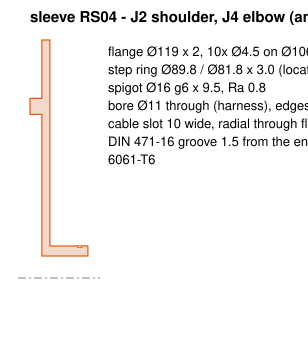
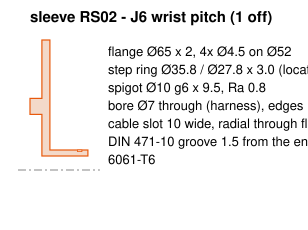

# Pitch-joint sleeves (turned, 6061-T6)

Generated by `fab.py`. One sleeve per pitch joint. It locates in the holder's plate B, clamps
under the motor's back-face screws, and carries the straddler's plate B on a flanged plain
bushing. The harness enters through the radial slot in the flange, inside the 4 mm cable gap,
twists along the bore, and turns under the hub cap. Nothing else moves against it.

Stack, motor side first: motor back face, holder plate B (3) with the sleeve step in its centre
hole, sleeve flange (2), running gap (2) where the flange faces the straddler plate (a safe pinch gap,
under 4 mm), straddler plate B (3) on the bushing, bushing flange (1.5) outboard, retaining ring,
then the hub cap, bonded to straddler plate B with a VHB ring.

## RS04 sleeve - J2 shoulder, J4 elbow (and the elbow rig), 3 off

| feature | size |
|---|---|
| step | ring Ø89.8 / Ø81.8 x 3.0, locates in plate B's Ø90 centre hole, stops 0.2 short of the motor |
| mass | 71 g |
| flange | Ø119 x 2, 10x Ø4.5 on Ø106, clamped with plate B by the back-face screws |
| spigot | Ø16 g6 x 9.5, Ra 0.8: running fit for the 16 x 18 x 3, flange 24 bushing |
| bore | Ø11 through, edges broken R1 (harness) |
| cable slot | 10 wide, radial, through the flange and step into the bore |
| groove | DIN 471-16, 1.5 from the spigot end |

## RS02 sleeve - J6 wrist pitch, 1 off

| feature | size |
|---|---|
| step | ring Ø35.8 / Ø27.8 x 3.0, locates in plate B's Ø36 centre hole, stops 0.2 short of the motor |
| mass | 22 g |
| flange | Ø65 x 2, 4x Ø4.5 on Ø52, clamped with plate B by the back-face screws |
| spigot | Ø10 g6 x 9.5, Ra 0.8: running fit for the 10 x 12 x 3, flange 18 bushing |
| bore | Ø7 through, edges broken R1 (harness) |
| cable slot | 10 wide, radial, through the flange and step into the bore |
| groove | DIN 471-10, 1.5 from the spigot end |

The RS02 sleeve's Ø7 bore takes the flat harness but not a connector: thread it before crimping.

The elbow rig uses the RS04 sleeve, so the rig qualifies this exact part.
