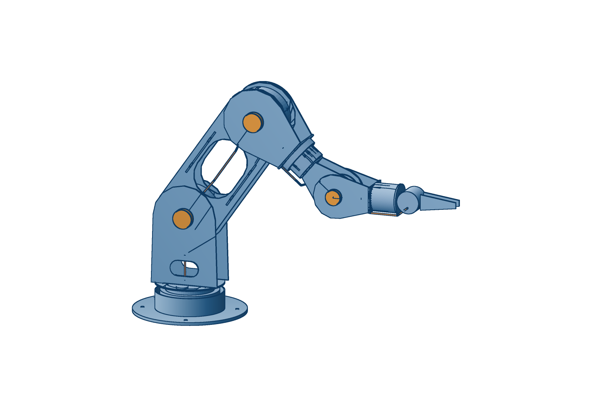

# rose arm — fork concept

The design the box / bone iterations in `arm/` led to. Same RobStride actuators,
same flat-sheet-on-the-4040 manufacturing, a different kinematic idea.

```bash
python3 arm/fork/rose_fork.py --summary                 # quick numbers
python3 arm/fork/fork_checks.py                         # mass, torque, stiffness
python3 arm/fork/audit.py                               # interference, pinch points, joint ranges
python3 arm/fork/dfm.py                                 # process, bed fit, webs, unique parts
python3 arm/fork/fab.py                                 # fab package: DXFs, nests, BOM, sleeves -> fab/
python3 arm/fork/rose_fork.py '{"J2_sho_pitch": -55}' > pose.loon   # posed world geometry for vcad-render
```



## The idea

**Every pitch joint is a fork.** The parent holds the motor's stator ring
between its two side plates. The child straddles the parent: one plate bolts to
the output flange, the other rides a plain bearing on a hollow sleeve on the
joint axis. Parent and child share one centreline, so there are no offsets, no
zig-zag and no twist lever from an offset elbow.

**Links taper wide to narrow.** A link is wide at the joint behind it, where it
straddles, and narrow at the joint ahead, where it holds the next motor. That is
a constraint of the nesting that turned out to be the look.

**Cables never loop outside.**

- Pitch joints: the harness passes through the hollow sleeve on the axis. It only
  twists, so there is nothing to pinch or snag.
- Roll joints (forearm, tool) and base yaw: a clock-spring cassette in a collar
  coaxial with the joint. Collar halves are fixed / turning; the seam is the only
  moving interface and the cable is inside it.
- Inside links: in the inner slot of the bottom 2020 bars.

**Structure.** Two windowed 3 mm side plates, two 2020 bars along the bottom
corners, recessed 1.5 mm covers top and bottom. That closes the section for
torsion while the side plates are what you see.

## v9 (2026-10-13): complete - every part ready to cut


**Fab package in `fab/`**, generated from the model by `fab.py`:

- `parts/`: one DXF per unique router part (20), with outline, bolt patterns, bores, windows and slots
- `nest/`: one arm's parts on the 390 mm bed, three 3 mm sheets and one 6 mm. The 392 mm
  upper-arm plates go on at 21°.
- `BOM.md`: motors, stock, purchased parts, and 88 screws listed by interface. Each screw length is
  checked against the motor's thread depth.
- `SLEEVES.md` and `sleeve_*.svg`: the two turned sleeves, RS04 (3 off with the rig) and RS02

What changed to get there:

- **Real interfaces.** RS04, RS02 and RS00 come from their manual drawings (INTERFACES.md). Every
  motor is **mounted by its back face**. Plate A is a clearance plate round the nose, and the
  straddler bolts to the output through a 3 mm spacer disc. Every gap in the stack is 4 mm.
- **Every plate is flat and parallel.** v8's forearm flared 7° to reach round the J5 motor, so its
  plate could not sit flat on the elbow spacer. Now both roll motors are **cartridges**: the
  forearm and the wrist end in a cross plate, and the RS02 or RS00 back-mounts on its far face.
- **Tabs and slots** locate the covers, both end plates, the yoke bridge and the turret towers.
  The side plates' flat ends tab through the end plates.
- **One 3 mm stock** for every plate, covers included (6 mm foot only). Hub caps are closed cups.
- **Stiffness sees the lobe bores.** At each upper-arm lobe only the ring round the Ø102 / Ø90
  bores bends: 0.03 → 0.13 mm sag, still inside the 0.5 mm budget.
- **Sleeves are in the mass**, at 70 g each (RS04) and 22 g (RS02).

| | v8 | v9 |
|---|---:|---:|
| mass | 8.23 kg | 8.21 kg |
| moving mass | 5.59 kg | 5.64 kg |
| jaw tips from the shoulder | 693 mm | 731 mm |
| holds straight out, continuously | 1.49 kg | **1.49 kg** (wrist and shoulder bind together) |
| sag / twist | 0.03 / 0.10 mm | 0.13 / 0.11 mm |
| elbow / wrist range | ±110° / ±125° | −120…115° / ±135° |
| interference, 209 poses | none | none |
| DFM web violations | — | none (upper plates nest diagonally) |

Open:

- RS02 back-face and output thread depths are assumed at 6 mm, so measure before ordering screws.
- The yoke bridge turns about 1 mm in front of the stationary RS02 nose face. That is a safe pinch
  gap, but the flange proud height needs checking on a real motor.
- The crush points from `audit.py` still need a policy: soft limits, or force limiting.
- The cable loops under the two roll cartridges are drawn, but the clock-spring turns for roll
  are not designed yet.

## v8 (2026-10-13): DFM and efficiency pass

`dfm.py` classifies every part by process and checks router rules (bed fit,
webs >= 1.5 t and >= 4 mm, tool access); `audit.py` checks interference.

| | v7 (hybrid wrist) | v8 |
|---|---:|---:|
| mass | 9.54 kg | **8.23 kg** |
| moving mass | 6.49 kg | 5.59 kg |
| holds straight out, continuously | 1.13 kg | **1.49 kg** (shoulder binds; wrist 1.66) |
| plate stock | 1.5 / 3 / 4 / 6 mm | 3 mm (+ 1.5 mm upper covers, 6 mm foot) |
| unique router parts | 18 | 13 |
| turned parts | 6 | 1 (the steel sleeve, hidden) |

What moved the numbers: holder plates get a hole inside the motor's bolt circle
(that face only covers the motor); span-fitted windows; hub caps as thin cups
(117 g → 5 g each - they had been modelled as solid steel); a flat 3 mm yoke
bridge instead of an 8 mm disc (177 g → 24 g); B plates 4 → 3 mm with a 4 mm
single-layer cable gap; turret disc 6 → 3 mm windowed; the tower foot trimmed to
the disc it stands on (it overhung); forearm cover slivers removed; jaws and tool
flange 3 mm. The base collar is a printed part.

Still open from DFM: the upper-arm plates are 392 mm - they nest diagonally on
the 390 mm bed, not square; the RS02 stator bolt circle (lobe hole size) is an
estimate until its drawing is read; tabs and slots for the covers and bridge are
not yet modelled; the stiffness model does not yet see the lobe holes.

## v7 (2026-10-13): hybrid wrist

RS02 at forearm roll and wrist pitch, RS00 at the tool roll. Three motor models.

## v6 (2026-10-13): one plate family, flat sheet only

Same two motor models as v5. What changed is how few kinds of thing there are:

- **The shoulder motor is flipped onto the upper arm.** The upper arm now holds
  identical RS04s at both ends between parallel plates: a constant-width bone
  with the same lobe at each end. The turret straddles it from outside. The
  motor's mass is on the shoulder axis, so the flip costs no gravity torque.
- **Roll motors live inside the links.** The forearm-roll RS00 sits inside the
  forearm's far end, the tool-roll RS00 inside the wrist link. No collars.
- **No 2020 bars.** Plates and flat covers only — the arm is all 3 mm sheet.
- **The base is a flat foot** with the yaw RS04 standing on it in a slim collar.
- **Cables are drawn honestly.** At each pitch joint the cable leaves the holder
  through plate B just outside the motor (under the other link's lobe), crosses
  an 18 mm gap with each leg flat on its own plate, meets the other leg on the
  axis inside the hollow sleeve, and turns under an orange **hub cap** — the one
  accent on the arm, and the only length of cable that twists. Inside the upper
  arm it runs down the centreline, seen through the windows.

| | v6 |
|---|---:|
| holds straight out, continuously, no spring | **1.28 kg** (wrist binds; shoulder 1.41, elbow 4.7) |
| shoulder / elbow / wrist range | −150…+120° / −170…+150° / ±150° |
| deflection | 0.04 mm sag, 0.09 mm twist |
| mass | 8.9 kg |

## v5 (2026-10-13): two motor models

RS03 is not available (RobStride sells RS00, 01, 02, 04, 05, 06). The search
in `size_actuators.py --available` ranks every selection by continuous hold,
then by number of distinct models: **RS04 at base yaw, shoulder and elbow;
RS00 for the three wrist joints.** No third model helps. The base yaw is an
RS04 for its large output bearing — it carries the arm's whole tipping moment.
Shoulder and elbow are now the same joint, same lobes and bolt pattern.

| | v5 |
|---|---:|
| motor models | 2 (RS04 x3, RS00 x3) |
| flange from shoulder | 703 mm |
| holds straight out, continuously, no spring | **1.24 kg** (wrist binds; shoulder 1.32, elbow 4.6) |
| peak payload | ~6 kg (wrist pitch) |
| mass | 8.9 kg (4.7 kg moving) |
| deflection | 0.03 mm sag, 0.09 mm twist |
| shoulder / elbow / wrist range | −150…+65° / −170…+125° / ±120° |

The elbow rig (`rig/`) is now an RS04 joint, so it qualifies the shoulder too.

## v4 (2026-10-13): bigger motors, no springs — superseded (RS03 unavailable)

Holding a pose is a stall, and the vendor's stall-continuous ratings
(INTERFACES.md) left v3 unable to hold anything without the gas spring. v4
sizes up instead of adding parts: **shoulder RS04, elbow RS03**, wrist RS00 x3,
reach 783 → 743 mm. `size_actuators.py` searches every combination with the
arm's own weight re-computed.

| | v4 |
|---|---:|
| flange from shoulder | 743 mm |
| holds straight out, continuously, no spring | **1.24 kg** (wrist binds; shoulder 1.28, elbow 1.71) |
| peak payload | ~6 kg (wrist pitch) |
| mass | 7.5 kg (4.2 kg moving; the extra is in base and turret) |
| deflection | 0.04 mm sag, 0.11 mm twist |
| shoulder / elbow / wrist range | −150…+75° / −165…+140° / ±120° |

Ceiling: with RobStride's ratings, ~1.25 kg continuous straight out is about the
limit at this reach without springs — the shoulder RS04 carries the whole arm.
Straight out is the worst case; bent working poses hold more.

## Numbers (v3, 2026-10-12) — superseded by v4

| | fork v3 | reBot B601-RS |
|---|---:|---:|
| DOF | 6 + gripper | 6 + gripper |
| flange from shoulder | 783 mm | 754 mm |
| mass | 6.3 kg | 6.7 kg |
| shoulder, 2.5 kg straight out | 35.1 N·m bare (98 % peak), 19.2 with spring | — |
| elbow | 17.5 N·m (48 %) | — |
| wrist pitch | 6.4 N·m (45 %) | — |
| flange deflection | 0.05 mm sag, 0.13 mm twist | — |
| shoulder range | −150° … +120° | |
| elbow range | −170° … +125° (both ways) | |
| wrist pitch range | ±120° | |

Masses come from true plate areas minus windows; actuators from the vendor
table. Fold ranges are swept against every primitive; pairs that touch by
design (collar halves, a plate on its sleeve) only count if they get closer than
they sit at zero.

## Iterations

- v1: the idea. 4 mm plates, four bars, solid base. 852 mm reach, ~8 kg.
- v2: 3 mm windowed plates, two bars, collar cassettes on the roll joints, hollow base, jaw gripper.
- v3: reach 853 → 783 mm, shell collars, turret windows. Shoulder back under peak bare.

## Open

- gas spring placement (inside the turret, acting on a crank on the upper arm's inner plate)
- the sleeve bearing: flanged bushing on a turned boss (4th axis)
- clock-spring cassette design: flat-ribbon or loose spiral, sized to ±180°
- plate edge chamfers (vcad 3D fillet drops sketch-extruded solids today)
- sim: URDF from this geometry, rerun hold / power-cut / duty
