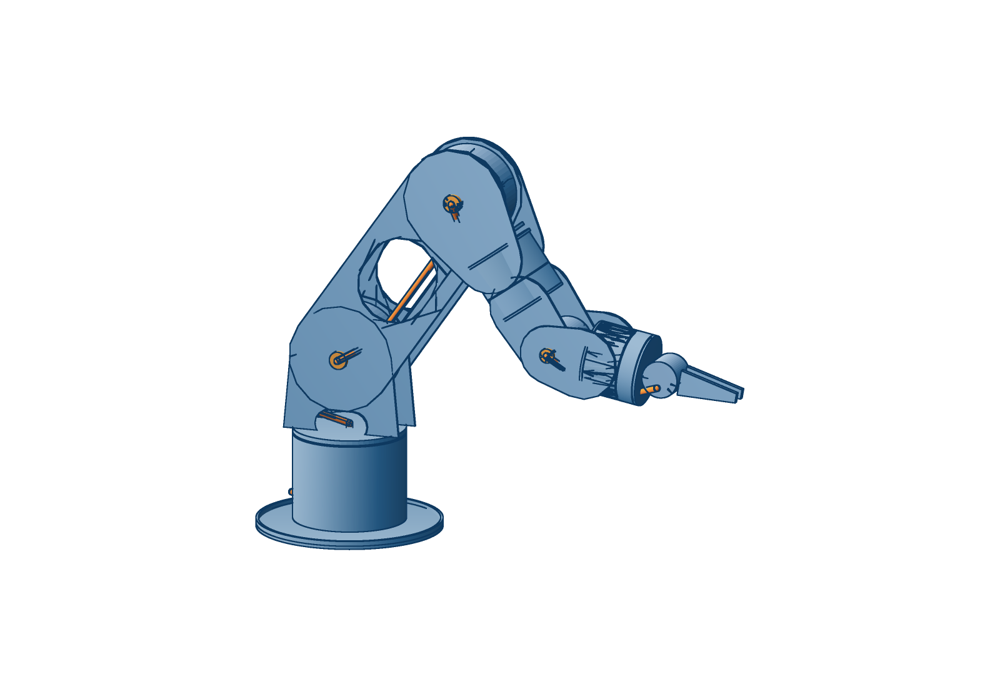

# rose arm — fork concept

The design the box / bone iterations in `arm/` led to. Same RobStride actuators,
same flat-sheet-on-the-4040 manufacturing, a different kinematic idea.

```bash
python3 arm/fork/rose_fork.py --summary                 # quick numbers
python3 arm/fork/fork_checks.py                         # mass, torque, stiffness, fold ranges
python3 arm/fork/rose_fork.py '{"J2_sho_pitch": -55}' > pose.loon   # posed world geometry for vcad-render
```



## The idea

**Every pitch joint is a fork.** The parent holds the motor's stator ring
between its two side plates. The child straddles the parent: one plate bolts to
the output flange, the other rides a plain bearing on a hollow sleeve on the
joint axis. Parent and child share one centreline, so there are no offsets, no
zig-zag and no twist lever from an offset elbow.

**Links taper wide to narrow.** A link is wide at the joint behind it, where it
straddles, and narrow at the joint ahead, where it holds the next motor. That is
a constraint of the nesting that turned out to be the look.

**Cables never loop outside.**

- Pitch joints: the harness passes through the hollow sleeve on the axis. It only
  twists, so there is nothing to pinch or snag.
- Roll joints (forearm, tool) and base yaw: a clock-spring cassette in a collar
  coaxial with the joint. Collar halves are fixed / turning; the seam is the only
  moving interface and the cable is inside it.
- Inside links: in the inner slot of the bottom 2020 bars.

**Structure.** Two windowed 3 mm side plates, two 2020 bars along the bottom
corners, recessed 1.5 mm covers top and bottom. That closes the section for
torsion while the side plates are what you see.

## v5 (2026-10-13): two motor models

RS03 is not available (RobStride sells RS00, 01, 02, 04, 05, 06). The search
in `size_actuators.py --available` ranks every selection by continuous hold,
then by number of distinct models: **RS04 at base yaw, shoulder and elbow;
RS00 for the three wrist joints.** No third model helps. The base yaw is an
RS04 for its large output bearing — it carries the arm's whole tipping moment.
Shoulder and elbow are now the same joint, same lobes and bolt pattern.

| | v5 |
|---|---:|
| motor models | 2 (RS04 x3, RS00 x3) |
| flange from shoulder | 703 mm |
| holds straight out, continuously, no spring | **1.24 kg** (wrist binds; shoulder 1.32, elbow 4.6) |
| peak payload | ~6 kg (wrist pitch) |
| mass | 8.9 kg (4.7 kg moving) |
| deflection | 0.03 mm sag, 0.09 mm twist |
| shoulder / elbow / wrist range | −150…+65° / −170…+125° / ±120° |

The elbow rig (`rig/`) is now an RS04 joint, so it qualifies the shoulder too.

## v4 (2026-10-13): bigger motors, no springs — superseded (RS03 unavailable)

Holding a pose is a stall, and the vendor's stall-continuous ratings
(INTERFACES.md) left v3 unable to hold anything without the gas spring. v4
sizes up instead of adding parts: **shoulder RS04, elbow RS03**, wrist RS00 x3,
reach 783 → 743 mm. `size_actuators.py` searches every combination with the
arm's own weight re-computed.

| | v4 |
|---|---:|
| flange from shoulder | 743 mm |
| holds straight out, continuously, no spring | **1.24 kg** (wrist binds; shoulder 1.28, elbow 1.71) |
| peak payload | ~6 kg (wrist pitch) |
| mass | 7.5 kg (4.2 kg moving; the extra is in base and turret) |
| deflection | 0.04 mm sag, 0.11 mm twist |
| shoulder / elbow / wrist range | −150…+75° / −165…+140° / ±120° |

Ceiling: with RobStride's ratings, ~1.25 kg continuous straight out is about the
limit at this reach without springs — the shoulder RS04 carries the whole arm.
Straight out is the worst case; bent working poses hold more.

## Numbers (v3, 2026-10-12) — superseded by v4

| | fork v3 | reBot B601-RS |
|---|---:|---:|
| DOF | 6 + gripper | 6 + gripper |
| flange from shoulder | 783 mm | 754 mm |
| mass | 6.3 kg | 6.7 kg |
| shoulder, 2.5 kg straight out | 35.1 N·m bare (98 % peak), 19.2 with spring | — |
| elbow | 17.5 N·m (48 %) | — |
| wrist pitch | 6.4 N·m (45 %) | — |
| flange deflection | 0.05 mm sag, 0.13 mm twist | — |
| shoulder range | −150° … +120° | |
| elbow range | −170° … +125° (both ways) | |
| wrist pitch range | ±120° | |

Masses come from true plate areas minus windows; actuators from the vendor
table. Fold ranges are swept against every primitive; pairs that touch by
design (collar halves, a plate on its sleeve) only count if they get closer than
they sit at zero.

## Iterations

- v1: the idea. 4 mm plates, four bars, solid base. 852 mm reach, ~8 kg.
- v2: 3 mm windowed plates, two bars, collar cassettes on the roll joints, hollow base, jaw gripper.
- v3: reach 853 → 783 mm, shell collars, turret windows. Shoulder back under peak bare.

## Open

- gas spring placement (inside the turret, acting on a crank on the upper arm's inner plate)
- the sleeve bearing: flanged bushing on a turned boss (4th axis)
- clock-spring cassette design: flat-ribbon or loose spiral, sized to ±180°
- plate edge chamfers (vcad 3D fillet drops sketch-extruded solids today)
- sim: URDF from this geometry, rerun hold / power-cut / duty
