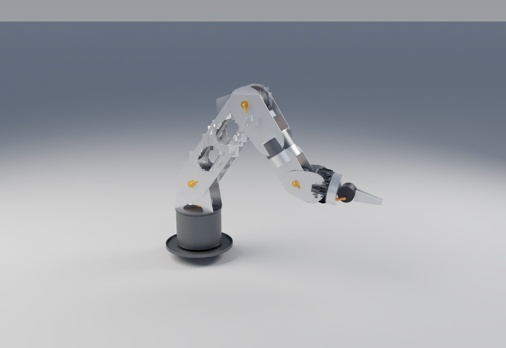

# rose arm — fork concept

The design the box / bone iterations in `arm/` led to. Same RobStride actuators,
same flat-sheet-on-the-4040 manufacturing, a different kinematic idea.

```bash
python3 arm/fork/rose_fork.py --summary                 # quick numbers
python3 arm/fork/fork_checks.py                         # mass, torque, stiffness, fold ranges
python3 arm/fork/rose_fork.py '{"J2_sho_pitch": -55}' > pose.loon   # posed world geometry for vcad-render
```



## The idea

**Every pitch joint is a fork.** The parent holds the motor's stator ring
between its two side plates. The child straddles the parent: one plate bolts to
the output flange, the other rides a plain bearing on a hollow sleeve on the
joint axis. Parent and child share one centreline, so there are no offsets, no
zig-zag and no twist lever from an offset elbow.

**Links taper wide to narrow.** A link is wide at the joint behind it, where it
straddles, and narrow at the joint ahead, where it holds the next motor. That is
a constraint of the nesting that turned out to be the look.

**Cables never loop outside.**

- Pitch joints: the harness passes through the hollow sleeve on the axis. It only
  twists, so there is nothing to pinch or snag.
- Roll joints (forearm, tool) and base yaw: a clock-spring cassette in a collar
  coaxial with the joint. Collar halves are fixed / turning; the seam is the only
  moving interface and the cable is inside it.
- Inside links: in the inner slot of the bottom 2020 bars.

**Structure.** Two windowed 3 mm side plates, two 2020 bars along the bottom
corners, recessed 1.5 mm covers top and bottom. That closes the section for
torsion while the side plates are what you see.

## Numbers (v3, 2026-10-12)

| | fork v3 | reBot B601-RS |
|---|---:|---:|
| DOF | 6 + gripper | 6 + gripper |
| flange from shoulder | 783 mm | 754 mm |
| mass | 6.3 kg | 6.7 kg |
| shoulder, 2.5 kg straight out | 35.1 N·m bare (98 % peak), 19.2 with spring | — |
| elbow | 17.5 N·m (48 %) | — |
| wrist pitch | 6.4 N·m (45 %) | — |
| flange deflection | 0.05 mm sag, 0.13 mm twist | — |
| shoulder range | −150° … +120° | |
| elbow range | −170° … +125° (both ways) | |
| wrist pitch range | ±120° | |

Masses come from true plate areas minus windows; actuators from the vendor
table. Fold ranges are swept against every primitive; pairs that touch by
design (collar halves, a plate on its sleeve) only count if they get closer than
they sit at zero.

## Iterations

- v1: the idea. 4 mm plates, four bars, solid base. 852 mm reach, ~8 kg.
- v2: 3 mm windowed plates, two bars, collar cassettes on the roll joints, hollow base, jaw gripper.
- v3: reach 853 → 783 mm, shell collars, turret windows. Shoulder back under peak bare.

## Open

- gas spring placement (inside the turret, acting on a crank on the upper arm's inner plate)
- the sleeve bearing: flanged bushing on a turned boss (4th axis)
- clock-spring cassette design: flat-ribbon or loose spiral, sized to ±180°
- plate edge chamfers (vcad 3D fillet drops sketch-extruded solids today)
- sim: URDF from this geometry, rerun hold / power-cut / duty
