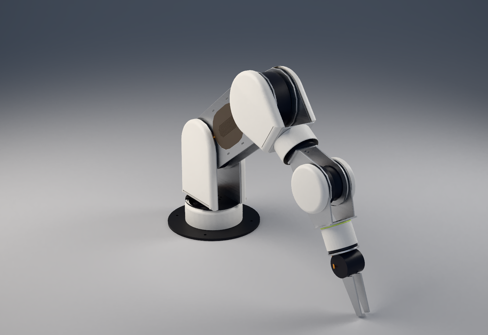
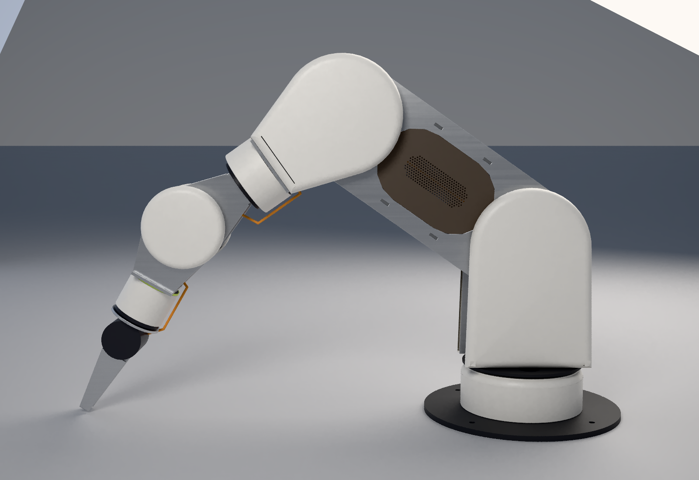
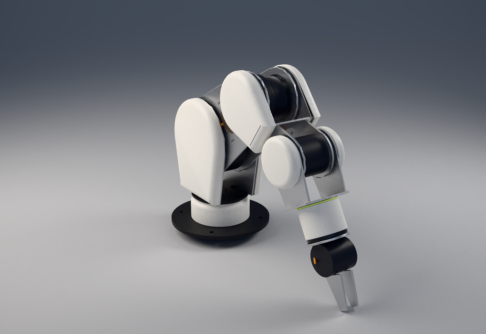
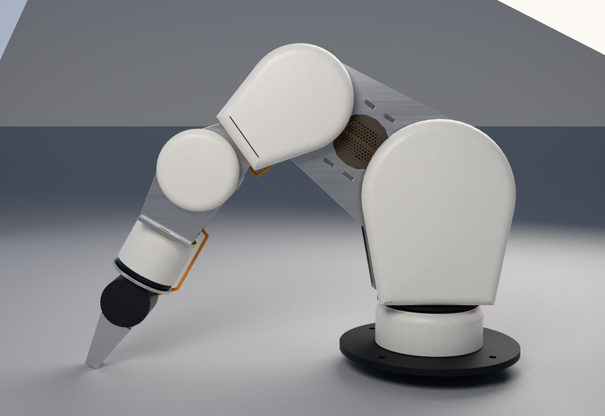
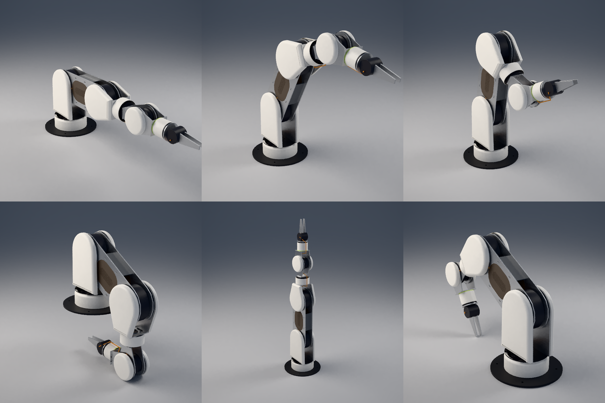

# lymb exterior: a design proposal

**Status: proposal, for Cam's approval. Nothing here is ordered or fabricated.** It sits on top of the arm
manager's build package (`claude/lymb-build`, bea880d) and changes nothing in it. Plates, motors, joints,
reach, the load path and the harness route are the same parts in the same places. Every piece here is a
cover over that structure.

## The language, carried over from cortex / quad00

| cortex / quad00 | on the arm |
|---|---|
| soft generous rounds | every cover is a *pad*: one flat face with a 10 mm quarter round all the way round it (8 mm on the wrist hubs, a rolled lip on the sleeves) |
| calm flat planes | the turret and forearm cheeks are single flat dead-front faces, with no fasteners, seams or vents on them |
| flush perforated dot-grid inserts | the upper arm's plate windows are filled flush with a perforated insert: a dead-front plane with a centred dot field (1.6 mm holes on a 3.0 mm hex, the cortex ear scaled up), plus a harness port |
| fast-evaluating inserts | as in the cortex tub, the holes live only in the insert, a part of its own. The insert evaluates once (about 110 s) and is cached; the shells evaluate in about 1 s |
| palette | cream #e8e1d2 shell with warm-black #1e1813 inserts (or the reverse). The aluminium plates and black motors show where they already show |
| one small neon accent | a 2 mm ring at the root of the tool-roll sleeve: the arm's status light |

## What goes where

The fork sets one rule. At a pitch joint the child straddles the parent, with a 4 mm gap between their
plates. So a link can wear a fairing only where it is the outermost plate. Anything thicker on the inner
link would close that gap and cost range.

| link | cover | why this one |
|---|---|---|
| base | **drum**: a turned 1.2 mm skin 0.3 mm over the printed cassette collar, top 3 mm under the turret disc, bored so the harness and cassette pass | the tool and wrist can come within ~3 mm of the base, so the turned skins (drum, sleeves, ring) add only 1.5 mm of radius |
| turret | **two cheeks** over the tower plates (16.5 mm deep; the shoulder hub cap and harness crossing sit inside) | the towers are outermost at the shoulder |
| upper arm | **flush inserts** in both plates' windows, the same 3.175 mm thickness as the plate | it is straddled at both ends, so nothing may stand proud of its plates |
| forearm | **two cheeks** over the forearm plates (the elbow hub cap and the end plate's edges sit inside), plus a **J5 sleeve** on the full arm | outermost at the elbow |
| wrist | **two round hubs** over the wrist lobes, plus a **J7 sleeve** and the accent ring | a full wrist cheek swept the forearm cheeks at J6 ±106° on the mini. A disc on the axis sweeps onto itself |

All the geometry is in [`shell.loon`](shell.loon), in three functions: `x-pad` (rounded cup),
`x-insert` (flush perforated insert) and `x-turned` / `x-ring`. [`exterior.py`](exterior.py) takes
each loop from the arm model's own numbers, places it in its link's frame (so the shape cache hits
across poses), and writes the posed loon. `ROSE_ARM=mini` dresses the mini arm from the same code. A
mega size will get covers as soon as `rose_fork.py` has a mega variant: no cover dimension is typed in
by hand.

## Added mass (PC/ABS 1.15 g/cm³; pads 2 mm wall, turned skins 1.2 mm)

| link (joint behind it) | full | mini |
|---|---:|---:|
| J1 base yaw | 29 g | 16 g |
| J1 / J2 turret | 152 g | 112 g |
| J2 / J4 upper arm | 72 g | 12 g |
| J4 / J5 forearm | 119 g | 58 g |
| J6 / J7 wrist | 56 g | 40 g |
| **total** | **429 g** | **238 g** |

Per-cover breakdown: `python3 arm/fork/exterior/exterior.py --summary`.

A cover's mass rides on the joint *behind* its link. The added arm torque comes mostly from the forearm
and wrist grams. Check the J2 / J6 hold margin before approving: it is heat-limited at 13 %, and the
covers add mass and enclose air.

## Clash check (`python3 arm/fork/exterior/clash.py 15`)

Every cover is checked against every structural solid of every other link, against every other cover,
against its own link's parts (at the zero pose, material only), and against the harness centreline
grown by its 1.5 mm radius. Pitch joints are swept every 15° over the arm's limits (every 30° when three
pitch joints are in the chain), rolls every 45°. Only the joints between the two links are swept, and
only poses that the bare structure reaches without a collision count.

Full results: [clash-full.txt](clash-full.txt), [clash-mini.txt](clash-mini.txt).

| | full | mini |
|---|---|---|
| single-joint ranges (each joint alone, 1°, to the limits) | **all six untouched** | all untouched except **J4 +115 → +114°** (the J7 accent ring meets the foot) |
| covers vs their own link (zero pose) | none | none |
| covers vs harness | none | drum 0.6 mm at J4 +115 (same corner as above) |
| covers vs other links / each other, multi-joint grid | 4 hits, all against the **foot disc** | 4 hits, foot disc or the jaws over the drum |

Every multi-joint hit is a pose where the bare plates already clear the foot by only 1.5–5 mm: the wrist
folded backwards over the base, the forearm folded down onto it, or the jaws over the collar. Any cover
with thickness removes those poses, and on a table or a torso mount they are within a few mm of the
mounting surface anyway. Nothing collides anywhere else in the joint grid.

## Renders

`python3 arm/fork/exterior/render.py OUT cream 128` (photoreal, CPU tracer, shop finishes from `scenarios.py`)

| | |
|---|---|
|  |  |
|  |  |

Pose sweep (reach, raise, fold, down, up, over):

## Open, for Cam

1. **Cream or warm black** for the shell. Renders show cream shells with warm-black inserts.
2. **The neon family accent colour.** It is a placeholder lime (`NEON` in `exterior.py`) until the master plan names the family's neon.
3. **Fastening.** Not designed yet. The proposal is magnets or snap tabs into the existing plate windows and bolt heads, with no new holes in any plate, but that is not drawn.
4. **Heat.** The inserts close the upper arm's windows to about 26 % open, and the J5 / J7 sleeves wrap their motors. The hold rating is heat-limited, so this needs a thermal check before the covers are approved.
5. **Process.** At one-off quantity these are SLA or MJF prints. Moulding comes later, if the family goes to volume.

6. **Mini J4 +115°.** Losing 1° could be avoided by dropping the accent ring to a flush paint line on the sleeve, or by moving the accent elsewhere.

### Seen in passing (structure, not changed here; for the arm manager)
- Mini: the harness crosses plate B at the shoulder 0.4 mm inside the end of the window (cable centre 64.0 mm, window from 64.4 mm), so it grazes the plate edge. The insert gives it a notch.
- The modelled harness through the J5 / J7 cassettes is a straight chord, so it cuts the motors at large roll angles. The sleeves stop short of the chord, but the real coil path has not been drawn yet.
