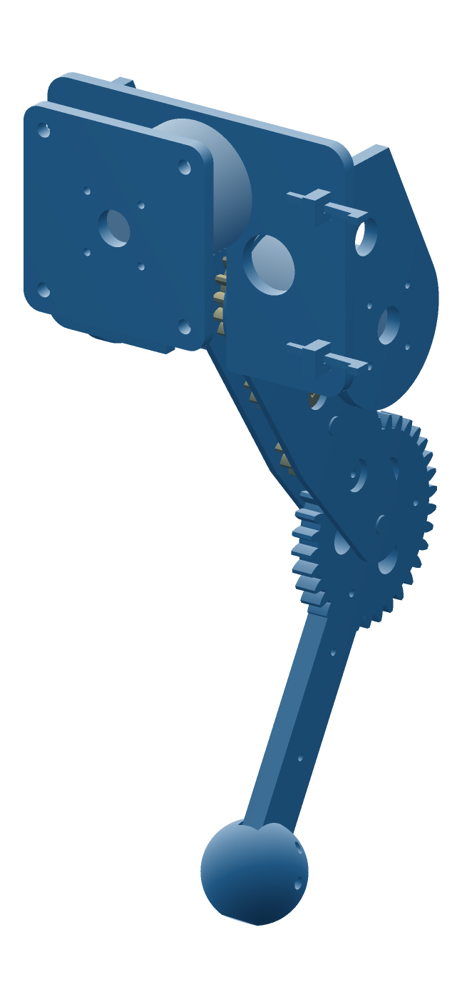

# quad00 leg

One leg of an RS00 quadruped, as a bench rig. All twelve joints of the dog are RobStride RS00.
The knee is driven from the hip through a gear train cut from the same flat stock as everything else.
There are no belts, rods or cables.



```
carrier ── hip RS00 (outboard) ──> thigh-outer plate ┐
        └─ knee RS00 (inboard) ──> pinion z17        │ thigh fork, 2 × 3.2 mm
                                    idler z17         │ idlers on M8 shoulder bolts + 8×10×8 plain sleeves
                                    idler z17         │
                                    knee gear z34 ════╧═ shin (same 3-layer laminate) ── paw (TPU)
```

| | |
|---|---|
| links | thigh 148.75 (hip to knee axis), shin 150, standing hip height 255 |
| knee | 2:1, module 2.5, 20°, 3 × 3.2 mm face; 0.2 mm backlash per mesh (`BACKLASH`) |
| stock | 3.2 mm everywhere; gears and shin are 3-layer laminates |
| width | 134 mm over the carrier; the leg itself is 17 mm thick |
| ranges | knee folds to 35° interior (shin meets idler 2); hip ±129° from down (carrier bridge) |
| mass, leg below carrier | 455 g aluminium / ~120 g printed, + 2 × RS00 (620 g) |

## Files

```bash
pip install shapely trimesh manifold3d ezdxf mapbox_earcut numpy
python3 leg.py              # checks + out/dxf (router, one file per distinct layer) + out/stl (print)
python3 leg.py --check      # gear mesh sweep, stack, ranges only
python3 leg.py --assembly   # posed parts + out/assembly/leg.loon
vcad-render out/assembly/leg.loon --azimuth=-55 --elevation 18 --size 1400 --fill 0.9 --auto-aspect -o render/leg-iso.png
```

DXF names are `part-Lk_3.2mm_xN`, where N is how many to cut for one leg. `_csk-1` means one of
those N gets 90° M3 countersinks; the countersink circles are on layer `CSK_M3_90DEG`.
STLs are fused laminates, already lying flat for printing. `out/3mf/` has the same parts laid
out on three Bambu P1S plates (256 × 256): `plate1_PETG_links` (shin and both thigh plates),
`plate2_PETG_gears-carrier` (2 carriers, 2 idlers, pinion), `plate3_TPU_paw`. Open each one in
Bambu Studio, set the filament and process, and slice. The pinion and outer thigh plate are valid
manifolds (manifold3d, genus = their hole count), but they have coincident vertices at the
countersink seams, so a strict mesh check may flag them. Bambu repairs this on import.

The pinion hub layer is 3.6 mm in the STL. In aluminium, cut it from 3.2 mm and add a 0.4 mm shim
under it, so the teeth sit centred between the thigh plates.

## Printed prototype

The goal is fit, backlash, range and stair clearance. It is not built to take load.

- **Material:** PETG, or nylon-CF if you have it. Print the gears flat, at 0.12–0.16 mm layers, with 100% infill on the gears.
- **Knee current limit:** cap the knee motor at about **4 N·m** (PLA/PETG teeth). That is enough to stand
  (~1 N·m) and step slowly. Do not jump on printed teeth. In aluminium at RS00 peak × 1.5 shock, the Lewis safety factor is 2.1.
- **Real hardware:** see [assembly.html](assembly.html) for the full list and the build steps
  (`out/assembly-guide.html` is the same page with the images inlined). Corrections to earlier notes:
  the bushings are plain 8×10×8 sleeves, **not flanged**, because a flange won't fit in the 0.4 mm
  gear-to-plate gap. The shafts are Ø8 × 20 shoulder bolts, with two 1.6 mm washers under each head
  so the shoulder sets the 16.8 mm plate spacing.
  The inner thigh plate runs directly on the printed pinion hub (Ø34).

Tests:
1. Backlash at the paw: lock the knee motor, rock the shin, measure.
2. Knee range under power, 35° to straight.
3. On a real 180 mm step, the crouched poses where the stair sweep found a gear strike (hips ≤ 240 mm
   above the nosing line).
4. Standing load under the current limit; watch the teeth for creep.

## Open

- Tooth wear is not checked. Hard-anodise the aluminium version.
- The aluminium build needs a real bushing or bearing for the inner plate on the hub.
- RS00 stall torque is an estimate, scaled from the RS06 manual.
- The ab/ad and torso aren't designed yet. The carrier is a bench rig.
- 455 g of aluminium per leg is above the ~0.4 kg the RS00 sizing assumed. The shin and gear laminate (202 g) is the place to lighten.
