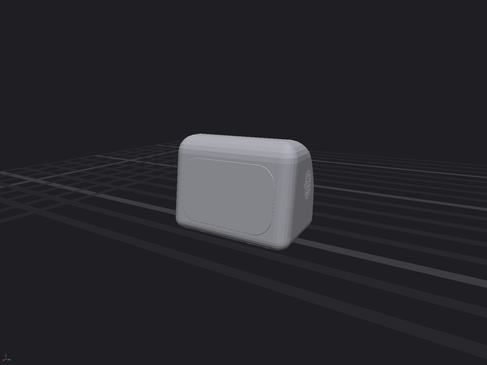
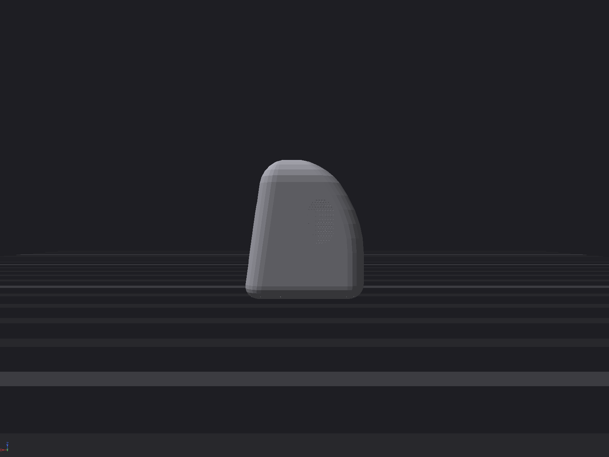
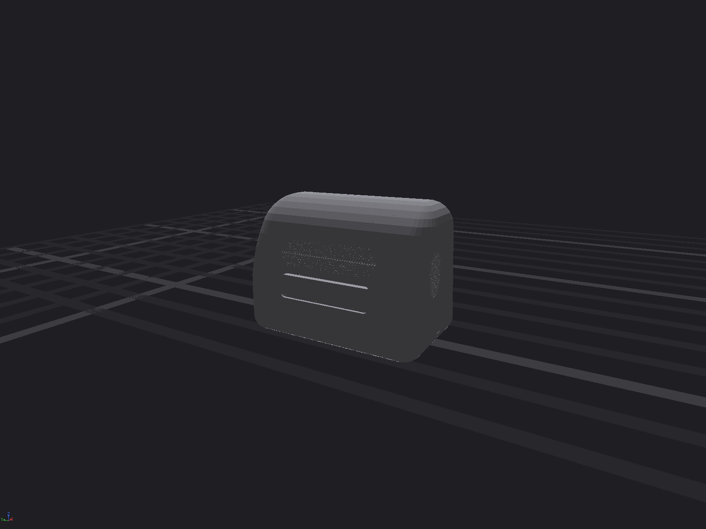
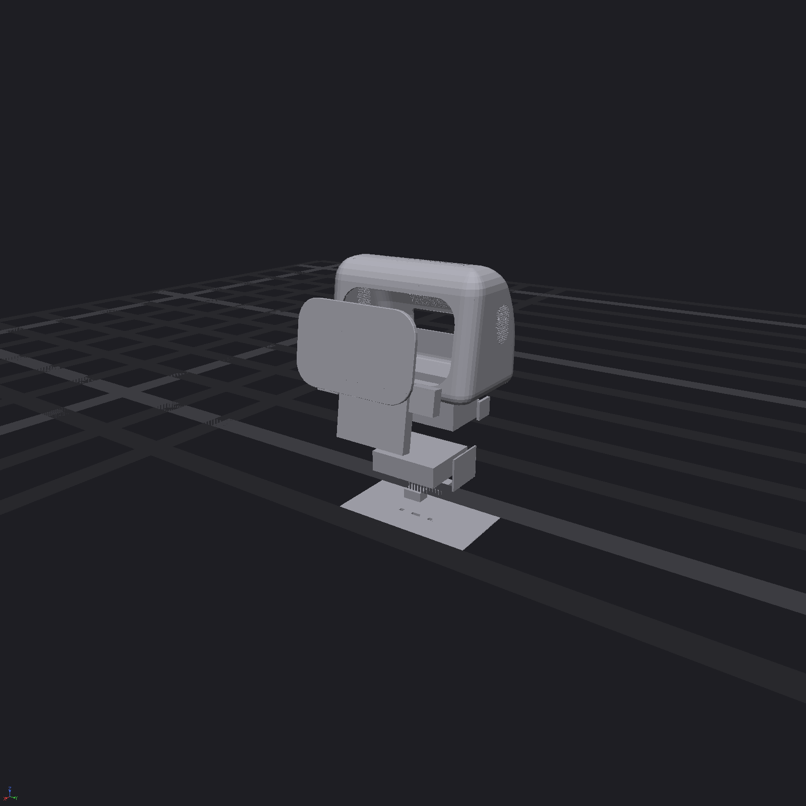

# Cortex head: spec

The cortex is the rose robot's head, sold as its own product. It contains the Jetson, its own battery, the face, eyes and ears. It sits on any rose body's neck dock, or works standalone on a desk.

The design source is [`cortex.loon`](cortex.loon), at mini size. Numbers here match that file. Open numbers point at the bench list, [`fab/MEASURE.md`](../fab/MEASURE.md); nothing is invented.

## Requirements

| Item | Value | Notes |
|---|---|---|
| Compute | NVIDIA Jetson Orin NX 16 GB on Seeed A603 carrier (87 × 52) | The carrier's I/O edge shows through the back cutout. Any carrier with a back I/O edge in the same envelope fits. |
| Compute power, design point | **25 W** (the module's MAXN mode) | MAXN SUPER (JetPack 6.2, about 40 W) is **not** supported by this shell. See the thermal section. |
| Other loads | display about 2 W, amps up to 2 × 1 W, cameras and mics under 1 W | Estimates. |
| Max fan-inlet air temperature | about 40 °C at 25 W in a 25 °C room | From the airflow calculation below. The heatsink's rating at that inlet temperature: bench, [MEASURE.md](../fab/MEASURE.md) #1. |
| Max operating temperature (module / Tj) | bench, [MEASURE.md](../fab/MEASURE.md) #2 | The limit comes from the NVIDIA Orin NX thermal design guide. |
| Display | Waveshare 3.5" HDMI (E), IPS 640 × 480 | The eyes are drawn on this screen. |
| Cameras | 2 × IMX219, 106 mm baseline, behind the dead-front glass | Each sees through a clear window in the glass's black print. |
| Speakers | 2 × Visaton K 28 WPC BL (Ø28, 8 Ω, 1 W) with 2 × MAX98357A | Stereo, one behind the top of each ear grid. |
| Mics | 2 × SPH0645 (I2S MEMS) | Both ports sit on the same dot row, so the pair is level. |
| Battery | 3S1P 21700 (Molicel P45B class), 11.1 V, about 50 Wh, with 3S BMS | Lies flat directly over the dock. |
| Dock (head side) | sealed floor: 8 flush gold pads (2 × 4, 4 mm pitch), 2 cone seats at y ±18, 2 steel strike discs at y ±30, latch keeper slot at x +20 | Pads: VBUS ×2, GND ×2, 1000BASE-T1 P/N, USB 2 D+/D−. Power 20 V / 5 A (2.5 A per VBUS pad, pogo pins rated 3 A). |
| Dock (body side) | 8 pogo pins, 2 tapered cones (Ø8 → Ø3, 6 tall), 2 × Ø8 × 3 magnets, spring pawl + push-button release on the back of the neck | `dock-*` lets in cortex.loon. A desk dock is the same parts in a weighted puck (charges through the pads). |
| Desk power | The desk dock puck (same pads), or the carrier's DC jack through the back cutout | No USB-C on the shell. |
| Ports | The carrier's own (USB, Ethernet, DC, power button) through the back cutout | No panel of the head's own. |
| Size | about 164 W × 104 D × 121 H mm; the face leans back 8° | |
| Total mass | bench, [MEASURE.md](../fab/MEASURE.md) #4 | Battery about 0.21 kg; everything else is unweighed. |

## Thermal check (first-order)

**Airflow path:** the heatsink's top fan pulls air from the open crown and blows it out through the aft fins. Those fins sit 3 mm from the exhaust grid, closed off by a foam gasket. Air comes in through the back I/O cutout and the open parts of the ear grids. The fan's flow direction is **ASSUMED**; checked on the bench ([MEASURE.md](../fab/MEASURE.md) #1).

**Required airflow:** heat removed by air is P = ρ·cp·Q·ΔT. With ρ = 1.16 kg/m³ and cp = 1007 J/kg·K:

| Power | ΔT (inlet to exhaust) | Airflow | Exhaust velocity | Total vent pressure drop (Cd 0.6) |
|---|---|---|---|---|
| 25 W | 15 K | 3.0 CFM | 2.2 m/s | about 15 Pa |
| 25 W | 10 K | 4.5 CFM | 3.3 m/s | about 34 Pa |
| 40 W | 15 K | 4.8 CFM | 3.6 m/s | about 38 Pa |
| 40 W | 10 K | 7.3 CFM | 5.3 m/s | about 86 Pa |

**Open vent area:**

| Vent | Before | After this check |
|---|---|---|
| Exhaust (back dot grid) | 69 holes × Ø1.1 = **66 mm²** | 417 holes × Ø1.4 = **642 mm²** |
| Ear grids, per side | 129 × Ø1.1 = 123 mm² | 161 × Ø1.4 = 248 mm² |
| Ear grids, open after the speaker and mic blank theirs (both sides) | | **40 mm²** (the speaker covers 100 holes, the mic 48) |
| Back I/O cutout (84 × 22) | | about 650 mm², **ASSUMED** 35% open around the connectors ([MEASURE.md](../fab/MEASURE.md) #6) |

**Result:**
- **Before: fail.** 25 W through 66 mm² needs about 21 m/s, about 700 Pa. No fan that fits the Orin NX heatsink can do that.
- **After: pass at 25 W.** About 3 CFM at about 15 Pa, which is within a small axial fan's curve (fan curve: [MEASURE.md](../fab/MEASURE.md) #1; real 25 W run: #2). Fan inlet is about 15 K over room temperature.
- **40 W (MAXN SUPER): marginal, not supported.** It needs about 40–90 Pa. Cap the module at 25 W in software.

**Change made:**
- Every grille now uses Ø1.4 holes on a 2.2 mm hex pitch, about 37% open (was Ø1.1 on 2.4, about 19%).
- The grilles are now separate perforated inserts that sit flush in plain windows in the tub. The tub moulds without side actions and evaluates in about 1 s (it was about 5 min with the holes drilled in). Each grille insert is cached on its own (about 75 s).
- The exhaust slot grew from 36 × 12 to 90 × 22 mm and moved up to z 76, right behind the heatsink.
- The ear grids are nearly blanked by the speaker and mic, so almost all intake comes through the I/O cutout.

**Still to do:**
- Get the real fan curve and heatsink rating.
- Run a CFD or vcad `simulate_flow` pass to check that hot exhaust isn't sucked back in through the I/O cutout just below it.

## Assembly room

Closest gaps, measured on the model. Zero means deliberately mounted together.

| Pair | Gap | Status |
|---|---|---|
| Speakers, amps, mics to tub wall | 0 | Wall-mounted on purpose (gasket or VHB). |
| Display, cameras to glass | 0.2 to 0.5 | Pressed against the glass on purpose (face frame). |
| Sled brackets to tub wall | **0.1 → 12** | Fixed: the brackets start 8 mm inside the carrier's back edge. |
| Carrier I/O edge to back wall | **0.8 → 2.3** | Fixed: the carrier moved 1.5 mm forward, so the tub slides down past the connectors. |
| Power board to side wall | **0.3 → about 3** | Fixed: moved 5 mm forward. |
| Heatsink to back wall | 2.9 | This gap is filled by the foam gasket. |
| Battery to receptacle board | 1.0 | Nothing goes in here (the plug mates from below). |

- **Tools:** every screw is reached from above with the tub off, or from below through the floor. No tool goes inside a closed head.
- **Cable bends:** the modelled runs have square corners. The tightest real bend is the dock USB 3 cable in the 11 mm channel under the battery: Ø3.5 cable, 10 mm minimum bend radius, so it must turn before it reaches the channel. The CSI and HDMI flex cables fold flat.

## Mounting

Order of assembly: build the sled on the floor plate, connect the two tub harnesses, lower the tub over the sled, then fit the floor screws.

| Part | Held by | Fasteners |
|---|---|---|
| Floor plate to tub | Tub bosses at the four bottom corners | 4 × M3 countersunk from below into heat-set inserts. *Bosses not modelled yet.* |
| Sled brackets (2 mm Al, folded foot) to floor | Clinch nuts in the floor | 2 × M2.5 per bracket |
| Carrier (A603) to brackets | Top flanges of the brackets | 4 × M2.5 standoffs. *Hole pattern: [MEASURE.md](../fab/MEASURE.md) #5.* |
| Heatsink to module | Its own spring screws | Supplied with the heatsink |
| Battery | Formed Al strap over the pack, onto the brackets | 2 × M2.5. Foam pad under it. |
| Pad board | Pocketed flush in the floor bottom, bonded; B2B up through the floor to the dock board | Adhesive + 2 × M1.6 |
| Dock board | Floor plate standoffs over the pad board | 2 × M2 |
| Keeper, strikes | Keeper: hardened steel plate over the latch slot. Strikes: steel discs pressed into floor pockets | Keeper 2 × M2; strikes press-fit |
| Power board | Nylon standoffs on the floor | 4 × M2.5 |
| Glass | 0.5 mm VHB in the stepped face opening | None |
| Display and cameras | Printed face frame bonded behind the glass; frame screwed to bosses in the tub face | Display 4 × M2.5, cameras 2 × M2 each, frame 4 × M2 |
| Speakers | Adhesive gasket ring onto the inner wall behind the grid, foam behind | None |
| Amps and mics | VHB on the wall. Each mic has a gasket ring around its port dot. | None |
| Heatsink-to-grid gasket | 3 mm foam frame | None |
| Tub-side wiring (face, ears) to sled | 2 × JST-GH harness connectors, 60 mm service loop | None |
| Head to body | Cones take shear and twist; magnets pull it flat (OPEN: at y ±30 they overhang the neck's dock plate, ±29.7, and trim, ±32.7); spring pawl locks it (pull-off rated by the pawl: [MEASURE.md](../fab/MEASURE.md) #3); button on the back of the neck releases | None (tool-free) |

## Exterior: frozen

The exterior shape is frozen as of this spec. It changes only if a check above forces it.

Already-forced changes, all in the thermal check:
- larger grille holes
- a wider exhaust slot

## Renders

 
 
